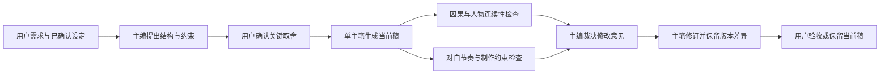
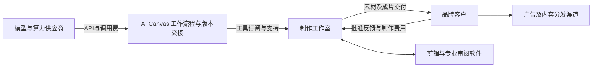

# AI Canvas 产品战略与多模型协作验证

调研日期：2026-11-05。决策窗口：未来 30／60／90 天。状态：研究建议，未实施产品改动，尚未进行客户或产品对照验证。

**目前没有足够证据证明 AI Canvas 已有必须使用、持续付费的理由，也不能证明多模型集群能进入行业前三。** 现有功能提供了验证起点；下载、Star、功能数量、单篇好剧本均不能替代真实付款、第二次使用和合格交付成本。

最有希望的一句话购买理由是：**让有固定品牌客户的 3—12 人视频制作工作室，把同一活动的第二批短片素材，复用已批准资产与制作流程完成并可靠交接，相比模型官网、文件夹和剪辑软件之间往返，降低达到客户标准的总成本。** 证据强度较弱：公开资料支持内容生产、资产复用与审批确实存在，尚未证明这个细分客户愿意购买 AI Canvas，或我们比现有工具做得更好。

只选这一主攻验证切口；备选为已有授权素材和稳定委托的连续短内容／短剧制作工作室。此选择不构成产品转向或开发授权，先验证两周，再决定是否投入。

## 1 未来几个月与多模型集群的判断

2026-11-06 已将该方向细化为[同任务多模型团队规划](./2026-11-06-multi-model-agent-teams.md)，补充通用协议角色绑定、GitHub 固定提交参考、产物/评审合同与 CLI/Codex 的组合；仍为待实施方案。商业与质量验证继续按本专项，不把实现编排等同于已经证明收益。

用户提出 GPT 做结构、千问做剧本，Kimi、豆包、DeepSeek 等模型共同参与。这个方案具有实验价值，但角色分工应由具体任务结果决定。不能把模型品牌与固定岗位永久绑定；“小黑马”对应服务与型号尚不明确，先作为待明确候选。此次没有调用这些候选模型进行比较，也未声称有跨模型讨论结果；研究由三个同模型子智能体分工，并追加了反方审查。

截至调研日，Runway Agent 已公开提供品牌资料、工作流、Skills 和变体制作等能力，FLORA 已销售多模型画布、MCP/API 和团队资产。它们的实际质量未在本轮实测，但足以说明基础编排面临直接竞争。[Runway Agent](https://runway.com/product/agent)、[FLORA 套餐](https://flora.ai/pricing)

以下是对 2026 年 11 月至 2027 年 2 月的条件式推演，不是已经发生的事实：

| 情景与观察信号 | 对 AI Canvas 的含义 | 决策 |
|---|---|---|
| 竞品继续把多模型路由和 Agent 纳入原有套餐 | 基础编排更难单独收费 | 以同任务交付结果定价，停止按接入模型数量证明价值 |
| 单模型更善于长上下文、工具和自我修订 | 简单任务的集群收益可能缩小 | 持续保留最强可用单模型基线，允许流程退回更简单配置 |
| 专业客户跨批次返工、版本与恢复问题持续存在 | 可靠复交可能比生成入口更有价值 | 观察真实第二批任务，验证资产和流程复用是否减少总工时 |
| 模型差异与接口变动持续存在 | 维护流程、版本和质量基线可能成为服务价值 | 只维护少数有实测收益的组合，不追逐所有“最新最强” |

多模型只有在错误互补、任务可拆、结果可核对，且增益覆盖调用与整合成本时才有价值。Google Research 对 180 种配置的研究发现，可并行任务可能受益，强顺序依赖任务可能退化；其任务不包含中文剧本，不能套用其中的提升幅度。[2026-01-28 官方研究](https://research.google/blog/towards-a-science-of-scaling-agent-systems-when-and-why-agent-systems-work/)

Anthropic 在研究系统中报告，多智能体约消耗普通聊天的 15 倍 token，并指出共享上下文和依赖很多的任务不适合直接拆分。这不是“多 Agent 比单 Agent 贵 15 倍”的通用结论，也不是 AI Canvas 的成本数据。[官方研究系统说明](https://www.anthropic.com/research/multi-agent-research-system)

### 剧本流程的最小候选结构

建议先用“一份已确认设定、一个主笔、最多两个独立检查者”，不要全员反复重写全文。

检查者只返回“问题位置、违反的约束、严重度、建议”，不直接写正文，也先不看另一检查者的结论。主编可以驳回意见并说明依据。最多一轮检查和一轮修订；超预算、服务失败或意见不能收敛时，保存当前稿，交由主笔或用户继续。不能用平均投票决定审美，也不能让模型自称“通过”代替验收。

GPT 主编、千问主笔是一种候选组合。先匿名比较各候选模型在结构、对白、人物一致性、可拍性和修改服从度上的表现，再分配角色。OpenAI 的官方建议同样是用相同输入、预先确定的验收标准比较模型，同时计入审阅和修复时间。[模型选择](https://developers.openai.com/api/docs/guides/model-selection)、[评估建议](https://developers.openai.com/api/docs/guides/evaluation-best-practices)

“行业前三”目前没有可支持的定义。后续最多能检验“在指定中文短内容任务、预算和参评工具中排名前三”：至少 30 个未参与调参的独立任务、3 名有交付经验的盲评者、至少 5 个充分配置的有效对照，报告分歧与排名不确定性。即使成立，也不等于全行业前三，更不等于客户会付钱。

## 2 客户切口的取舍

以下频率、预算和规模均为筛选及报价假设，不是已经发生的订单。

| 候选客户 | 使用者与付款者 | 触发任务与当前替代 | 采用障碍与选择 |
|---|---|---|---|
| **主攻验证：有固定品牌客户的 3—12 人视频工作室** | 制作人员、制作负责人使用；老板或负责人付费 | 每周同活动的第二批 15—30 秒短片素材、客户修改与复交；官网生成＋网盘＋剪辑＋聊天记录 | 必须减少真实返工，不能打断交付；以每团队每月 ¥699—1499、API 另付测试预算。频率与预算待核实 |
| **备选：有稳定委托的连续短内容／短剧工作室** | 分镜、生成师使用；制片或工作室付费 | 跨集角色、场景、镜头与客户意见复用；ComfyUI＋官网＋剪辑 | 长叙事、角色漂移与发行效果会混淆软件价值；只招有真实委托者，不以爱好者热情验证 |
| 电商卖家与个体自媒体 | 运营或创作者自用、自付 | 上新和日常内容；套餐工具、平台模板或外包 | 更希望直接买结果；画布、Key 和素材精度增加门槛。预算未知，暂不主攻 |
| ComfyUI 高手与通用自动化开发者 | 开发者自用；个人或技术负责人付费 | 探索、自建工作流与业务自动化 | 自建能力强、替代充分、支持问题复杂。可贡献反馈，不能默认是高付费客群 |

Adobe 2026 调研显示内容生产仍有流程和数据整合障碍，Wistia 报告则提醒视频需求上涨并不意味着预算上涨。这支持寻找效率问题，不支持“市场大所以小工作室会买”的推论；两者都是供应商研究，样本也不等同于中国小型制作团队。[Adobe 调研及方法](https://business.adobe.com/resources/reports/content-management-digital-trends.html)、[Wistia 2026 报告](https://wistia.com/explore/state-of-video-report)

选择品牌工作室，是因为第二批交付的成本更容易观察和归因。目前没有已核实的该类客户接触渠道；如果两周内找不到足够合格样本，必须承认获客可达性不足。短剧若出现更强的真实付款、复用及低支持成本证据，应推翻本推荐。

## 3 八类竞争与替代方案

价格为 2026-11-05 所读官方页面的美元或欧元公开展示，不能当作国内含税报价；月付与年付折算分开。功能为公开供给或厂商声明，未登录进行效果验收。

| 替代方案 | 价格与能力快照 | 为什么会替代我们 |
|---|---|---|
| [FLORA](https://flora.ai/pricing) 闭源创意画布 | Starter $18／席／月，Pro $50；列 API/MCP、实时协作及团队资产等权益；包含用量预算未充分核实 | 多模型、画布、复用、团队和用量已组合销售；基础聚合不是空白 |
| [Figma Weave](https://weave.figma.com/pricing)，原 Weavy | Team $42／用户／月、年付 $504，4500 月度 credits；企业列 BYOK/API。个人档月价与年额口径本次未能一致核实 | 直接覆盖工作流、编辑和共享；主 Figma 画布深度整合明确尚未提供，不能计入当前能力 |
| [ComfyUI](https://github.com/Comfy-Org/ComfyUI) 与 [Comfy Cloud](https://comfy.org/pricing) | 本地 GPL-3.0；Cloud Standard 月付 $20、年付折合 $16；Creator 月付 $35；GPU 与 Partner Nodes 另看规则 | 高级用户可自建，普通用户可托管。Team 的共享 workflow/assets/projects 当时仍列 Coming soon |
| [Runway](https://runway.com/pricing) 官网与创作平台 | Standard 月付 $15、年付折合 $12，625 credits；Pro 月付 $35、年付折合 $28，2250 credits；公开提供 Agent 等权益 | 上游直接提供品牌、变体、工作流和创作入口；网页会员不能当 API 进货价 |
| [Adobe Firefly](https://www.adobe.com/products/firefly/plans.html) 与专业编辑工具 | Standard $9.99／月、2000 credits；Pro $19.99／月、4000 credits，均列 Boards；具体组合按套餐 | 已有编辑习惯、品牌资产与采购关系，能把基础生成融入现有支出 |
| [n8n](https://n8n.io/pricing/) 工作流 | 年付展示 Starter €20／月、2500 次执行，Pro €50／月、10000 次执行；Agent、MCP、审批与执行观测 | 通用自动化成熟。其 [Sustainable Use License](https://github.com/n8n-io/n8n/blob/master/LICENSE.md) 不能当无条件开源或免费商业嵌入许可 |
| [Claude Code](https://claude.com/product/claude-code) 等通用 Agent | [Pro 月付 $20、年付 $200](https://claude.com/pricing)，有使用限制；提供子智能体与 MCP 等能力，也有 API 路径 | 技术用户能自行连接工具和材料；这不表示它直接替代全部视频工作流，但压缩通用 Agent 外壳价值 |
| 人工拼接与外包 | 官网＋文件夹/网盘＋剪辑＋表格/聊天，或由制作人员代办；总成本取决于已有订阅和工时，未知 | 已经熟练、灵活、无迁移；必须与客户当前最佳办法比较，不能只演示我们比手工复制更方便 |

输出可商用不等于所有模型、素材与用途都获得保障。[FLORA 条款](https://flora.ai/legal/terms-of-service)不保证第三方权利与输出质量；[Runway 使用权说明](https://help.runwayml.com/hc/en-us/articles/18927776141715-Usage-rights)与其 API 条款分别适用；Weave FAQ 指明存在模型例外，本轮其详细 Terms 链接无法读取，逐模型限制未知；[Adobe 的企业赔偿说明](https://www.adobe.com/ai/overview/firefly/gen-ai-approach.html)不能推广到所有套餐和第三方模型。

## 4 高 Star 项目实际学什么

下面为 2026-11-05 直接读取 GitHub 官方 API 的 Star 快照。Star、最后推送和 archived 标志都不等于稳定、仍有人维护或具有商业价值。已定向阅读所链实际源码与许可证，未安装或运行框架。

| 项目与 Star | 维护及许可边界 | 学习优先级 |
|---|---|---|
| [Dify](https://github.com/langgenius/dify) 160,463 | 未归档；当日有推送；修改版 Apache 2.0，多租户与前端品牌有条件 | 学每步骤模型配置、产物 schema 与成本记录；不搬整套后端 |
| [MetaGPT](https://github.com/FoundationAgents/MetaGPT) 71,183 | 未归档；最后推送 2026-01-21；MIT；维护意图未知 | 学上游产物就绪后才进入下一步，不照搬虚拟软件公司 |
| [AutoGen](https://github.com/microsoft/autogen) 61,711 | API 未归档，但固定版本 README 声明停止维护，推荐迁移；代码 MIT、文档 CC BY 4.0 | 历史参考，不作新生产依赖首选 |
| [crewAI](https://github.com/crewAIInc/crewAI) 60,535 | 未归档；当日有推送；MIT | 优先学有限任务、预期产物与顺序交接 |
| [Flowise](https://github.com/FlowiseAI/Flowise) 55,553 | 已归档，最后推送 2026-08-13；大部分 Apache 2.0，企业目录及标注文件另有商业许可 | TypeScript 局部设计样本，不预期持续维护 |
| [LangGraph](https://github.com/langchain-ai/langgraph) 44,512 | 未归档；当日有推送；MIT | 优先学状态更新契约、checkpoint 和中断 |
| [ChatDev](https://github.com/OpenBMB/ChatDev) 34,679 | 未归档；最后推送 2026-10-30；Apache-2.0；当前主分支为 2.0 | 学子图与讨论边界；不拿旧版公司角色当当前实现 |
| [Microsoft Agent Framework](https://github.com/microsoft/agent-framework) 14,546 | 未归档；当日有推送；MIT；AutoGen 推荐迁移方向 | 学绑定流程版本、决策与恢复点的语义 |

主要借鉴点及可追溯源码：

1. **LangGraph：共享状态按字段约束。** 节点返回部分状态更新，每个字段可定义 reducer；运行上下文与共享状态分开。借鉴人物设定、已批准结构、正文、审查发现分别管理，正文保持单写入者。不能用通用 reducer 自动合并多人文学改稿。[固定提交 StateGraph](https://github.com/langchain-ai/langgraph/blob/f35dc299b390bcaf5188f50a05ca23d148214a86/libs/langgraph/langgraph/graph/state.py#L131)
2. **crewAI：每一步说明预期产物。** 实际内容模板有规划者、作者、编辑和顺序任务，TaskOutput 区分文本与结构化产物。借鉴“约束→节拍表→场景表→带位置的问题→指定修订”。样例不是多模型中文剧本质量证据。[任务模板](https://github.com/crewAIInc/crewAI/blob/6bd60b223101a11f7ac675706ff1ebb03314c95d/lib/cli/src/crewai_cli/templates/flow/crews/content_crew/config/tasks.yaml)、[产物类型](https://github.com/crewAIInc/crewAI/blob/6bd60b223101a11f7ac675706ff1ebb03314c95d/lib/crewai/src/crewai/tasks/task_output.py)
3. **Dify：步骤模型与成本分开配置。** 每个 LLM 节点声明模型和结构化输出；执行记录有耗时、token、价格、币种；迭代有并行度与错误分支。业务不合格重做、网络重试、已付费任务恢复要分别处理。[LLM 类型](https://github.com/langgenius/dify/blob/e994c3ffe9482797df8546a921142868db4dc6ac/web/app/components/workflow/nodes/llm/types.ts#L11)、[执行记录](https://github.com/langgenius/dify/blob/e994c3ffe9482797df8546a921142868db4dc6ac/api/models/workflow.py)、[许可](https://github.com/langgenius/dify/blob/e994c3ffe9482797df8546a921142868db4dc6ac/LICENSE)
4. **Agent Framework：恢复决策状态。** checkpoint 包含流程签名、前驱、已提交状态与待回答事件，不应只凭轮次恢复。对应本项目，流程、材料或稿件变化后，旧检查意见不能继续当有效结论。[checkpoint 源码](https://github.com/microsoft/agent-framework/blob/07b9b3fc6f896cc4a0ac86e74cb11fc4d894ca19/python/packages/core/agent_framework/_workflows/_checkpoint.py#L35)

反例同样值得看：ChatDev 当前文章讨论样例的多个角色都配置为 gpt-4o，属于同模型多智能体，不能证明异构模型增益。[实际样例](https://github.com/OpenBMB/ChatDev/blob/464a681ba7bda869db97a50c5fa707c9a0fb57a0/yaml_instance/subgraphs/article_discuss.yaml)；AutoGen 的维护声明与代码许可应分别读取，不能只看 API 的归档标志或根许可证。[维护声明](https://github.com/microsoft/autogen/blob/d07c667a3239ea4ab7af62a53b0f4ff205a1f23d/README.md#L19)、[代码许可](https://github.com/microsoft/autogen/blob/d07c667a3239ea4ab7af62a53b0f4ff205a1f23d/LICENSE-CODE)；Flowise 的 [LLM 实现](https://github.com/FlowiseAI/Flowise/blob/9291856d1ea4a4ceea9f8fef8ce14f4f6c81e8eb/packages/components/nodes/agentflow/LLM/LLM.ts#L348)可参考局部模型绑定，但[许可](https://github.com/FlowiseAI/Flowise/blob/9291856d1ea4a4ceea9f8fef8ce14f4f6c81e8eb/LICENSE.md)与维护限制仍在。

当前不引入 Python/.NET 服务、另一套数据库、队列、凭据与权限系统。AI Canvas 已有 Registry、Policy、Agent Runtime 和持久化；先学成熟语义，再判断现有运行时的最小缺口。

## 5 仓库能证明的现有边界

以源码为准，下面的“已有实现”不表示本轮已经运行或验收通过。

| 状态 | 真实证据 | 对战略的含义 |
|---|---|---|
| 已有实现 | [subAgentService.ts](../../src/services/chat/subAgentService.ts) 第 138—204 行有父子任务、只读工具、组预算，以及 options.modelId 内部接口；[promptPolishService.ts](../../src/services/promptPolishService.ts) 已有显式传入模型的调用 | 存在异构路由基础，不需要从零再造引擎 |
| 角色模型配置仍有缺口 | [SubAgentProfile](../../src/types/subAgent.ts) 没有每角色模型字段；[公开派工工具](../../src/services/chat/tools/subAgentTools.ts) schema 只有 profileId、assignment，派工未传 modelId | 不能宣传用户现在已经能为每个角色配置不同模型的通用集群 |
| 已有实现 | 子 Agent 工具白名单为画布查询与 Skill 读取，禁止嵌套；返回文本，父任务落地；[agentTaskService.ts](../../src/services/chat/agentTaskService.ts) 重启修复为 paused | 适合有限只读审查；不是自主联网、制作、写画布的完整团队 |
| 已有实现 | [canvasDerivationGuard.ts](../../src/services/canvasDerivationGuard.ts) 校验项目与 revision；[videoBatchRunner.ts](../../src/services/videoBatchRunner.ts) 保留 unknown，重启不盲目重投 | 可用于验证避免重复付费、错误写回与恢复成本 |
| 已有实现但验收有限 | [分镜](../../src/services/shotlistService.ts)、[资产包](../../src/services/dramaAssetTransferService.ts)、[v3 项目归档](../../src/services/projectTransferService.ts)、[剪辑入口](../../src/services/videoEditorService.ts) | 可复用素材和交接基础；不等于输出一致性或客户一次通过率已经成立 |
| 已有实现及规划有明确区分 | [S3 模块](../文件与存储模块.md)为手动同步；[导入更新专项](./2026-10-30-project-import-update-merge.md)有三方合并与恢复点，仍有桌面缺口 | 不把项目交换、S3 当作多人实时共编；自动同步和实时协作不能提前计入价值 |
| 局部成本基础 | [方舟账本](../../src/services/billing/volcengineBillingService.ts)区分估算与 usage；[价格快照](../../src/services/billing/volcenginePricing.ts)标记 2026-09-26 | 不是实时全厂商官方账单，也没有完整合格交付成本 |
| 尚无证据的设想 | 本次定向抽查未见实际付款队列、自然复用、客户批准率、完整人工分钟和跨厂商交付成本证据 | 这些先用人工记录取得，不能靠增设一批功能证明 |

## 6 API 优势与单位经济

单次 API 便宜不能证明合格交付便宜。官方快照：方舟 Seedream 4.0／4.5 为 ¥0.20／¥0.25 每张输出；Seedance 2.0 的特定 720p、16:9、5 秒、无视频输入示例为约 ¥4.97。Runway Gen-4 Turbo／Gen-4.5 API 为 $0.05／$0.12 每秒。规格、审核、输出格式和实际 usage 不同，不能直接评判性价比。[方舟价格](https://docs.volcengine.com/docs/ark/model-pricing?lang=zh)、[Runway API 价格](https://dev.runwayml.com/pricing)

### 客户每次合格交付总成本

全周期成本＝全部已计费调用＋废稿及失败成本＋修正、剪辑、审核人工＋存储传输＋软件分摊。每次合格交付成本＝全周期成本／客户验收合格的交付数。放弃项目和未交付尝试也计入分子；合格数为零时报告“无合格交付”及全部损失，不能删除该样本。不要把同一失败同时计入调用总额和重试倍数两次。

**假设算例：**一个物料包需要 6 个合格 5 秒镜头及 6 张图片；视频每次 ¥5、图片每次 ¥0.20，文本每包 ¥2；人工 ¥100／小时；每团队 ¥699／月、每月 10 包。这里的尝试倍数为每个合格产物对应的平均计费输出数，不假设所有技术失败都收费。

| 每个包的假设 | 保守 | 基准 | 乐观 |
|---|---:|---:|---:|
| 平均计费尝试倍数 | 6 | 3 | 1.5 |
| 全部调用成本，约 | ¥189 | ¥96 | ¥49 |
| 修正、剪辑与审核总工时 | 5 小时 | 2.5 小时 | 1.25 小时 |
| 人工成本 | ¥500 | ¥250 | ¥125 |
| 软件分摊 | ¥70 | ¥70 | ¥70 |
| 存储传输 | ¥2 | ¥2 | ¥2 |
| **合格交付总成本，约** | **¥761** | **¥418** | **¥246** |

这不是现有产品产能或客户现状。基准情景下，视频单价从 ¥5 降到 ¥4 只省 ¥18；少返工半小时省 ¥50。若便宜模型使尝试数和人工上升，低价可能增加总成本。API 成本必须与相同验收标准下的客户最佳旧流程比较；其旧流程成本目前未知。

### 我们的贡献与盈亏

平台贡献＝订阅及托管收入－模型采购－支付渠道－基础设施－支持人工－退款。获客、研发、管理、税务再列，不能把客户节省的工时记为我们的利润。

以下仍全是假设：BYOK 团队订阅 ¥699／月，支付费 3%，支持人工 ¥100／小时，API 由客户直接向供应商支付。

| 每团队每月 | 保守 | 基准 | 乐观 |
|---|---:|---:|---:|
| 支持工时 | 8 小时 | 1.5 小时 | 0.5 小时 |
| 基础设施 | ¥30 | ¥20 | ¥15 |
| 退款准备 | ¥35 | ¥14 | ¥0 |
| **获客前贡献，约** | **－¥187** | **¥494** | **¥613** |
| 每月获客摊销假设 | ¥120 | ¥80 | ¥40 |
| **摊销后余额，约** | **－¥307** | **¥414** | **¥573** |

基准情景贡献率约 71%，不是净利润率。若一次性 CAC 为 ¥2400，按获客前贡献约 4.9 个月回本；要求 3 个月回本则 CAC 应不高于约 ¥1482。这与表中获客摊销是不同分析口径，不重复扣除。若每月固定支出假设 ¥4 万，按 ¥414 余额至少需约 97 个持续付费团队才能覆盖；支持负担、流失和新增获客都会改变结果。

100 个团队每月 ¥699，仅约 ¥83.9 万年收入，尚未扣成本。高回报取决于有效价格、可达客户数、留存和低服务负担，不能从软件毛利或行业规模推导保证。

### 收费方式与上游风险

| 方式 | 当前取舍 | 盈亏与依赖 |
|---|---|---|
| **BYOK＋团队流程订阅** | 首先验证；先按工作室／活跃制作人员小组定价，不向所有审阅者收费 | 对减少返工和复交收费，客户承担模型费；Key、余额与供应商故障仍有支持成本 |
| 平台代付／托管用量 | 后置，不包无限生成 | 要有适用合同、限额、对账与退款机制；上游涨价、重度用户及坏账直接侵蚀利润 |
| 混合模式 | 只有 BYOK 开户确实阻碍付费，且客户愿为便利付费时再做 | 软件费与模型费分列；保留可替代来源，不能承诺跨模型无损迁移 |
| 按工作流交付收费／导入服务 | 可用于有范围上限的人工辅助试点，费用与工时单列 | 能验证结果价值；每单需要创始人代做则是服务业务，不能冒充软件规模化 |
| 企业定制、生态抽成与市场 | 暂不铺开 | 尚无采购、供需密度、渠道或标准化证据 |

托管加价 15%、支付渠道按总流水 3% 的假设下，每 ¥1000 上游调用只剩约 ¥115.5，尚未扣退款、汇率、支持和获客。会员额度也不能转为 API 采购折扣；[Runway FAQ](https://help.runwayml.com/hc/en-us/articles/50683115755155-Runway-API-FAQs)明确两者分开。

上游降价会削弱低价卖点，涨价会压缩托管贡献，断供及规则变化会损害交付，直销会吸走轻需求客户。Runway 当前 API 条款有面向终端应用的品牌展示要求；豆包服务条款对地域、转售和服务形态有条件。取得 Key 不等于获得裸转售或任意地域服务权，应用集成也不能一概判为禁止，托管前应核对实际合同。[Runway 条款](https://runway.com/terms-of-use)、[豆包服务协议](https://docs.volcengine.com/docs/ark/doubao-model-service-agreement?lang=zh)

## 7 复用与长期积累

首次价值应在一个已有真实 brief 中出现：找到获批资产、完成指定修改、输出可交接文件，并能解释花费与失败。空白画布、配置几十个模型或看一次漂亮演示不能算激活。

第二次价值必须在同一客户的新任务中验证：复用批准的参考与流程，带入上次修改结论，缩短准备和返工，而非复制一份项目就宣布复用。每个模型升级或流程变更仍需重新检查质量。

长期可能积累的是客户授权的标准、带原因的修改与失败案例、经过验收的流程版本、团队的制作和审阅关系。资产首先属于客户；不得假设拥有跨客户训练权或独家数据。完整导出后，客户愿意留下，应是因为下一批制作、质量检查、维护与交接继续更省时，不能依靠无法拿走文件维持留存。

| 层次 | 当前定位 |
|---|---|
| 必要基础设施 | 本地文件、模型接入、MCP、权限、恢复、成本可见性；必须做好，竞争者也能做 |
| 短期差异 | 好用的角色库、模板、画布联动与预设；容易复制 |
| 需要时间的优势 | 被重复订单证实的流程、失败处理、客户信任和低支持成本；目前待证明 |
| 真正受控的稀缺资源 | 独家分发、排他合作、授权专有数据或难复制的交付网络；目前没有证据拥有 |

## 8 上下游合作与价值捕获

| 一方 | 谁获益、谁付钱、谁控制 | 可从小做的合作与被替代风险 |
|---|---|---|
| 模型供应商 | 得调用收入，控制模型、价格、规则和可用性 | 带来合规专业任务流；先用普通适用 API，无独家议价权，不为合作先承诺流量 |
| AI Canvas | 若有价值，收流程及维护费，管理任务、版本和交接 | 客户授权范围内处理资料；不给自己虚构分发权、数据所有权或效果保证 |
| 制作工作室 | 控制终端客户关系、判断、交付责任；是主要付款候选 | 与少数工作室共建一个标准任务，导入和培训有范围；帮助其提高毛利，避免与其争抢终端客户 |
| 专业交付软件 | 控制最终精修、文件格式和审阅习惯 | 优先标准文件交换与往返，不重造完整剪辑、审阅软件；其可把基础 AI 功能免费打包 |
| 品牌与分发渠道 | 品牌控制素材权利、批准与预算，渠道控制分发和效果数据 | 将客户反馈关联到制作版本；先不承诺投放收益或抢占渠道结算，合作条件与分成目前未知 |

早期较现实的获客是让有固定客户的制作负责人带入一条重复工作流，通过可公开的客户授权前后对照案例和专业制作社群触达同类团队。现有用户是否包含这些人、哪条渠道转化更好仍未知。先记录邀请数、合格数、付费数、获客工时和支持工时；不买广泛流量掩盖低转化。

供应商无需因为我们接了 API 就合作；渠道无需因为我们有画布就分发。议价权来自可以被证实的增量订单、低支持负担或专业用户入口，目前尚未形成。许可限制可阻止部分直接套壳，不能阻止竞争者独立实现同样功能；本项目是源码可用许可，不应对外误称无条件开源。

## 9 继续做 暂停做 暂时不做

| 选择 | 范围及理由 |
|---|---|
| **继续做** | 保留现有可靠性、资产、项目交换与明确恢复边界；先做成本和质量人工记录；限定时间验证多模型分工与真实第二批交付 |
| **暂停做** | 围绕单个剧本反复精修；把所有品牌最强模型都接成完整集群；预先固化“某模型永久负责某岗位”；未经对照继续扩张通用平台 |
| **暂时不做** | 无限生成、API 低价转售主模式、全套实时协作、完整市场生态、大客户定制、重写专业剪辑器、行业前三宣传 |

短剧方向不因沉没成本必须继续，也不因用户不满就全面否定。现有角色、场景、分镜与跨集复用可保留为备选资产。单个剧本只保留一小段有代表性的跨集材料作为质量和恢复试件；继续长篇创作必须另有作品项目目标，不能算软件商业验证。

## 10 最少必要缺口与依赖

先做第 1 项的证据工作，其余都是观察到对应瓶颈后才触发的候选，不直接排入开发。工作量仅为初步相对代价，具体改动仍需按源码与单独方案确认。

| 顺序 | 可复用能力 | 缺口与商业关系 | 代价及触发条件 |
|---|---|---|---|
| **1 合格交付证据** | 方舟账本、任务和文件产物 | 将批准/驳回原因、全部调用、人工分钟、交付数关联；证明节省是否存在 | 低：先表格和人工计时，暂不建评估平台；立即做验证准备 |
| **2 有限任务与版本契约** | AgentTask、Skill、项目记忆、checkpoint 和 revision 守卫 | 固定已确认设定、正文版本、审查问题与裁决；防止修改破坏已经批准的结果 | 中；只有丢约束与反复重解释是主要返工来源才开发 |
| **3 角色与具体模型的绑定** | 内部 modelId 路由、模型目录与 Provider | 用户可理解的角色模型、固定版本及失败回退；只在异构组合优于对照时有交付价值 | 中；先同预算盲评，不能直接加一张全能集群配置页 |
| **4 获批流程的再次使用** | 项目/全局资产、资产包、预设、分镜 | 将上次批准的输入、参数、修改结论带入下一真实任务，衡量第二次收益 | 中；先人工复用，至少三家真实再次使用后确定最小数据字段 |
| **5 交接与完整成本** | v3 归档、三方合并、手动 S3、账本 | 找到最小可靠交付清单及跨厂商账单/人工成本关联；支撑收费与信任 | 中至高；只有客户为交接和成本追溯付费时扩展，不先上实时共编或商业计费平台 |

多模型扩展仍须沿用 Store、Registry、Policy、任务组预算、凭据存储与派生结果守卫。外部框架的通用重试不能自动重投付费媒体；子智能体不因扩展模型就获得写画布或放宽材料权限。

## 11 七至十四天的低成本验证

下列样本、金额和阈值都是建议假设，由用户后续执行。此次未访谈、招募、收费、运行对照或调用付费模型。计划设研究侧新增调用上限 ¥1500、人员投入约 40 小时；已有套餐额度和创始人工时仍按真实成本记账。预算不足应缩小实验或停止，不能省略失败样本。

| 时间 | 执行与样本 | 产物与判断 |
|---|---|---|
| 第 1—3 天 | 筛选 8—12 家候选，争取 6 家符合条件；读取其最近一次真实交付与修改过程，取得授权，不只问“会不会用” | 至少 5 家有两周内第二批任务；记录工时、订单频率、现有工具、付款者与最主要返工原因。若可改善环节不足总工时 15%，优先否决切口 |
| 第 3—7 天 | 至少 5 家完成旧流程与 AI Canvas 的配对；用真实 brief 中两镜头及一次修改作小切片，另在 2—3 组加入一个直接竞品 | 同资产、规格、可用模型和总预算；训练后随机交叉顺序，记录熟练度差异。小切片不能推出全片产能 |
| 第 7—10 天 | 同一活动做第二批可比任务，检查获批资产与修改结论是否真能复用 | 第二轮要求相同但内容不同；比较准备、返工与交接。实验安排的第二轮只能证明复用能力，不算自然留存 |
| 第 10—14 天 | 给明确范围与实际软件价值报价，不用返现或代做补贴制造付款；观察非实验强制的新任务 | 至少 3 家按首月 ¥699 以上付款，至少 3 家主动完成另一个真实任务且研究者不代做，才进入下一阶段。没有新任务机会者列为未观察，不能算成功或失败留存 |

预先让付款方确定硬标准：品牌/商品/人物关键外观、文字、画幅、时长、必要素材与授权范围。隐去工具来源，由付款方及一名专业评审独立判断。主指标为每次合格交付总成本和总时间；同时记录一次通过率、一致性缺陷、返工次数、人工有效分钟、全部调用费、p50/p90 交付时间、恢复耗时与人工帮助。合格数、放弃数和失败数一起报告。

建议继续阈值：至少 5 家完成配对，合格交付总成本中位数降低 30%，质量硬标准不下降，至少 4 家获得改善；p90 时间不恶化。若改善不足 20%、只出现在演示、主要来自创始人代做、直接竞品同成本更好，或找不到真实付款，则停止当前收费假设；20%—30% 间保留为不确定，不据此扩大开发。小样本结果只用于决策，不宣称普遍有效。

### 多模型剧本的独立实验

先用 4 个开发样本调整任务契约，再用至少 12 个未见样本，包含不同题材、接续写作和指定修改。比较 A 最强可用单模型、B 同模型分角色、C 异构模型分工；A 也享有相同总预算和修订机会，避免一轮单模型对比五轮集群。固定具体型号、版本、推理设置、上下文和费用，不把“最新”当版本号。

匿名评审结构因果、人物动机、口吻连续性、对白节奏、制作可行性、约束遵守，并记录人工修订时间、放弃率与总费用。建议门槛：异构方案在不降低硬标准下，一次通过率至少提高 10 个百分点，或人工修订时间降低 20%，且合格交付总成本不恶化。12 个样本只能决定是否扩展，不能用于排行榜宣传。若优势只是更多采样或主编人工筛选，应保留更简单的方案。

恢复验收由用户在 Tauri 桌面隔离项目中执行：先用可控接口，覆盖断网、取消、关闭重开、切项目、上游已成功但本地保存失败。预期保留原任务与稿件，不自动重投付费调用，不把旧结果写入新项目。出现重复付费或错误写回，立即暂停相关交付承诺并定位。Web 演示不替代这些验收。

## 12 三十 六十 九十天的决策

以下时间相对正式开始验证日计算，均为建议门槛，不是收入预测。新增功能只由已观察到的问题触发。

| 节点 | 样本与业务门槛 | 允许投入与停止条件 |
|---|---|---|
| **30 天** | 累计约 20 次合格客户访谈、至少 5 个正常付费团队，完成至少 10 个真实交付批次；高频客户在 4 周中至少 3 周完成真实工作 | 仅补最主要的一个瓶颈。若付款依赖代做、没有自然复用或成本改善不足 20%，暂停主攻；备选必须独立取得证据 |
| **60 天** | 至少 10 个付费团队；首批有完整续费机会的客户至少 70% 实际续费，公布分母；30 个以上真实批次成本与质量数据；获客前贡献率约 60% 以上、持续支持不超过 2 小时／团队／月 | 测试一个获客渠道及一项有范围的合作；多模型只有通过对照才产品化。若不同客户持续要求不同定制，按服务业务重新核算 |
| **90 天** | 争取 20 个付费团队；对拥有完整 60 天观察期的队列报告留存，建议门槛 60%；成本优势持续、支持约 1.5 小时／团队／月以内、CAC 回本不超过 6 个月 | 证据支持才扩大同类客户，不同时开多个市场；只有 BYOK 门槛明确阻碍收入时评估托管合同。若不能覆盖支持、无续费或优势被竞品免费替代，停止扩张或收缩为有利润的细分工具 |

保留的最强反对意见是：客户最昂贵的工作可能是审美、模型画面、客户改意和最终精修，资产组织只占很小部分；新画布反而增加配置和迁移。多模型也可能把这一问题变成更多意见与更贵的筛选。真正能推翻该反对的是相同标准下持续的付款、自然复用和成本优势；漂亮案例、更多模型或更复杂架构都不能代替。

本次只进行了公开资料核实与仓库静态抽查，新增研究文档。本次未运行测试，待用户验收；上述客户研究、对照与桌面步骤均未执行。现有工作区的 Tauri 生成权限清单改动未纳入本研究。
