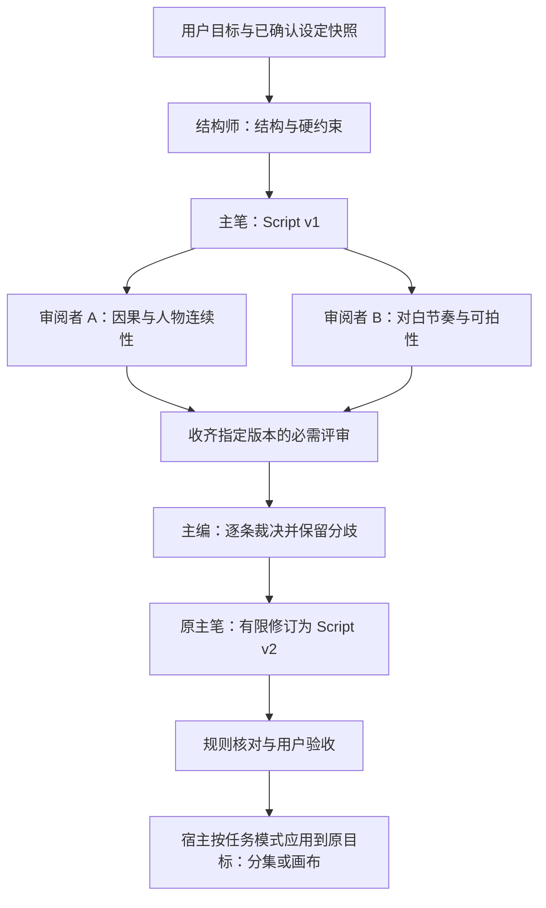

# 多模型 Agent 集群：同任务协作与剧本团队规划

> 日期：2026-11-06。状态：首期通用 API 团队与双入口之后，用户已确认并实施 [Harness 专项](./2026-11-06-harness-capabilities.md)中的 v2 任务图、组合包与固定 Codex 建议执行器。未运行本轮测试、类型检查、构建或真实模型调用，待用户验收；多模型质量对照仍未完成。
> 用户目标：多个主流模型共同完成同一任务，初步考虑 GPT 负责结构、千问负责剧本，Kimi、豆包、DeepSeek 等分工参与；各家模型通过通用协议接入，不限定「小黑马」为单独厂商。角色分工为可调整候选，尚无实测能力排名。
> 同日补充：用户要求 AI 助手与剧本创作工作台都能发起、查看和继续协作任务。两处共用 Team Run，首个可用版本须同时提供入口，不只将工作台动作转成助手待发送草稿。界面参考用户提供的两张截图，截图内稿件仅为布局参考，不是需要修改的内容。
> 调研阶段只读取公开 GitHub 源码和本仓库；用户随后明确要求「开始实施吧」。本轮按已批准范围编写代码和回归用例，未安装依赖；验证执行仍遵守仓库 `AGENTS.md`。下文设计与实施前基线用于解释边界，实际交付及缺口以第 8、10 节为准。

**目标：** 从助手或剧本工作台发起同一套多模型团队任务，让不同角色围绕版本化成果依次或并行工作，展示交接、分歧、修订和实际用量，最终由宿主按目标领域及现有权限应用到画布或剧本分集。

**架构：** 集中调度的 Team Run 管理角色、依赖、产物和预算；执行器先用现有通用文本 API，后续可接 Codex App Server。MCP、CLI 是任务入口，Skill 提供流程知识。首期是本机应用内的逻辑团队，不建设分布式服务器集群，不引入另一套 Python/.NET Runtime 或数据库。

主模块：[对话助手 Agent](../对话助手-Agent能力实施方案.md)。价值与客户验证沿用[产品战略与多模型协作验证](./2026-11-05-product-strategy-and-multi-model-validation.md)；执行器接入沿用 [Skill / CLI 与 Codex 规划](./2026-11-06-external-agent-collaboration.md)。本专项负责细化团队运行合同，不重复维护两份已有专项的进度。

## 1. 如何把三项能力结合

| 层 | 职责 | 与已有规划的关系 |
|---|---|---|
| 入口与操作知识 | 助手、剧本工作台、MCP、CLI 提交或查询任务，Skill 说明正确流程 | 助手与工作台是首期产品双入口；外部入口复用外部协作 A 线，所有入口查询同一任务与产物 |
| 团队编排 | 角色绑定、阶段依赖、并行汇合、版本、裁决、预算和恢复 | 本专项新增，主窗口为执行权威 |
| 执行器 | 通用文本 API；后续可选 Codex App Server | 通用 API 团队可先实施；Codex 仍须完成外部协作 B0 的版本、认证、隔离与预算前提 |
| 成果应用 | Registry、Policy、Store Action、历史及派生守卫 | 不为团队增加旁路权限，不让多个模型同时直接修改同一正文 |

「先由 GPT 整理剧本智能体结构」可落为首个团队模板的角色、输入、输出和验收规则；随后接入可替换的主笔与审阅模型。结构设计、运行编排与模型品牌分别配置，不把 GPT/千问写进调度代码。

### 1.1 双入口界面与调用体验

助手负责自然语言需求和完整协作轨迹，工作台负责带明确剧本位置的快捷操作；共用模板选择、角色模型配置、任务卡和结果比较组件，不分别维护任务引擎或剧本正文。

| 界面位置 | 拟定交互 | 状态与边界 |
|---|---|---|
| 助手输入框底部现有模型入口 | 增加紧凑「单模型 / 团队」执行选择；单模型保留当前模型，团队显示「剧本团队 · N 个角色」，点开查看模板、角色模型、材料范围及预算 | 顶部「规划 / 协作 / 自主」仍表示权限，不把新功能命名为另一种「协作模式」；切回单模型保留原选择，不覆盖项目助手模型设置 |
| 助手消息区及任务中心 | 发送后显示一张统一任务卡：阶段、成员进度、等待选择、成果与应用状态；可展开审阅和裁决 | 团队配置完整时独立校验角色模型，不能因未选择普通单模型而阻止发送；未配置团队时提供配置入口，不静默回退 |
| 工作台标题附近 | 增加「团队协作」入口，用于配置本次模板、查看本集团队任务与进入共享详情 | 不挤占原有「AI 拆分草案」「章节浏览」；小窗口使用有文字或可访问名称的紧凑入口，不依赖悬浮才可发现 |
| 工作台右侧现有创作动作区 | 在「结构创作 / 剧本写作」上方选择「单模型 / 团队」，保留现有动作名称；团队态点击动作进入共用任务摘要并明确开始，不复制一整列团队按钮 | 单模型动作保留原行为；团队选择不自动调用模型，不把普通用户全部切到高成本流程；工作台选择与助手输入草稿分别保存，团队模板目录共用 |
| 工作台右侧任务与结果区 | 展示本集任务的紧凑阶段卡、当前成果、差异及应用入口；「在助手查看」打开原任务 | 查看或切换入口不重新提交、不增加调用。助手中的「定位原稿 / 比较修订 / 应用到原位置」返回同一分集和字段 |

首期支持「优化本集大纲」「根据集纲写正文」「联合审稿」三个动作，两个入口都可调用。后续再补对白润色、节奏调整和创作要点等模板；不能为每个按钮都默认跑完整剧本团队：

- 优化大纲：结构分析、独立审阅、裁决和大纲修订，只针对大纲。
- 根据集纲写正文：已保存大纲与已确认设定作为上游，主笔、独立审稿、裁决与修订；没有明确要求时不重做整个结构。
- 联合审稿：对当前稿生成多维度问题和裁决，不默认重写正文；用户后续要求修订时沿用原任务和版本谱系。

共用配置采用现有 UI Kit 的按钮组、模型入口、卡片和提示样式，容器沿用 p-2/p-3 与 canvas token。处理未配置、发起中、运行、暂停、部分失败、候选就绪、冲突、应用中和已保存状态；键盘可切换/打开，焦点可返回，状态不只靠颜色表达，深浅主题和窄窗一并验收。团队设置保持一个权威入口，两处发起界面复用其配置，不复制角色配置维护。

### 1.2 实施前双入口基线

本节记录规划时发现的缺口，已实施变化见第 8 节，不代表当前源码仍缺少这些合同。

- [ChatInput.tsx](../../src/components/chat/ChatInput.tsx) footer 当前是单模型入口；[ChatPanel.tsx](../../src/components/chat/ChatPanel.tsx) 分别处理文本模型选择、Agent 模式和发送。[conversationExecutionController.ts](../../src/services/chat/conversationExecutionController.ts) 的发送合同目前没有团队执行选择，消息创建和执行分流仍依赖普通助手模型，需同步修改，不能只添加界面开关。
- [chatWindowService.ts](../../src/services/chat/chatWindowService.ts) 的 `ChatStateSnapshot` / `ChatAction` 当前没有团队目录、选择和动作；独立助手通过 [detachedChatSyncController.ts](../../src/services/chat/detachedChatSyncController.ts) 请求主窗口执行。团队沿用版本化快照/补丁，不在独立窗口重复调用模型或写库。
- [ScriptWorkbench.tsx](../../src/components/ScriptWorkbench.tsx) 的 `activeTab`、`draftsByEpisode`、`draftSignature` 为局部编辑状态。`openCreativeAction` / `openFieldPolish` 先保存脏稿，再调用 `openChatWithDraft` 填入助手草稿；当前没有直接派发团队任务。
- [seriesCreativeService.ts](../../src/services/seriesCreativeService.ts) 生成创作提示词，读取已保存的分集大纲/正文/创作要点并要求先给草案。[seriesTools.ts](../../src/services/chat/tools/seriesTools.ts) 的 `episode_update_script`、`episode_update_outline`、`episode_update_creative_field` 属 `file_write`，当前没有目标内容 hash/CAS 参数；[store.projects.ts](../../src/store/store.projects.ts) 的 `updateEpisodeCreative` 也不能当作已有内容 CAS 或画布撤销。

### 1.3 来源、稿件与同任务交接合同

拟增加 `TeamInvocationContext`，记录 `assistant / script-workbench` 来源、任务/会话归属、精确目标类型、剧集归属 ID、`episodeId`、`outline / script / creative.field`、动作、模板版本、材料引用/hash 及目标字段 hash。当前 tab 是展示上下文，不替代明确的目标字段；任务 `projectId/conversationId` 沿用现有归属解析，不能直接将剧集 ID、分集 ID 与会话项目 ID 混用。

1. **助手发起：** 显式引用与用户选择确定材料和应用目标。通用助手无项目时仍可做分析/写作团队，但不能因工作台打开或收到旧窗口快照而继承项目写权限；没有绑定目标时只交付候选，不猜测当前分集。
2. **工作台发起：** 首期沿用先保存后取快照，同时补保存期间的草稿版本保护：开始保存时捕获编辑版本/签名，成功后只清理仍匹配的局部草稿，保存期间的新输入保留；版本已变化则不启动团队。当前 `saveDraft` 成功后清理草稿不能直接当作已有此保护。保存失败不发起；成功后重新核对分集、编辑版本及目标，再捕获已提交字段。不能在另一窗口读取旧保存内容却声称使用了当前草稿。直接用未保存稿、精确选区改写是后续能力，须另定义内存快照和稳定定位合同。
3. **模式可见：** 有明确来源会话时捕获其 Plan/B/C；工作台独立发起且没有可继承模式时默认 B，在共用发起摘要中可见。不能从无关或隐藏会话默默继承自主模式。执行选择与权限是独立维度。
4. **只发起一次：** 主窗口的共用发起服务为一次提交生成请求身份，并原子绑定 Team Run；双击、窗口转发和重发同一请求只定位原任务，不重复调用模型。它是需要新增的合同，不假定现有 MCP 操作键可覆盖团队启动。
5. **排队即冻结：** 排队时固定执行选择、模板/角色模型、来源目标和材料版本；切换模型、团队、分集或 tab 仅影响新任务。追加要求在安全阶段边界形成新需求版本，使受影响下游成果失效，不能直接塞入任意在途角色。
6. **跨入口查看与继续：** 携带原 `taskId/teamRunId` 定位、暂停、继续或追加要求；不能经 `openChatWithDraft` 再发送原任务冒充“继续”。同剧集共享会话也不改变原目标分集。切集后保留来源标签，用户主动定位原集才打开对应正文，不因后台完成抢回界面。
7. **关窗和恢复：** 关闭工作台遵守既有未保存稿退出规则，并明确处理编辑会话；团队按冻结材料后台执行。独立助手关窗交接主窗口，不重启任务。重新打开任一入口按任务 ID 恢复展示，应用重启后仍只恢复暂停，不自动继续调用。

### 1.4 剧本结果应用与编辑冲突

两个入口共用候选比较和主窗口应用服务；默认先展示候选，不将查看、预览或打开工作台当作保存。所属模式允许且任务明确要求自动应用时，仍须通过下面同一组校验，不另增 C 模式逐次确认规则。

- **分集内容与画布分开执行：** 分集大纲、正文和创作字段走 `file_write` 及对应 Store 保存；画布节点走 `canvas_write` 与历史。不能对剧本分集写入承诺已有画布撤销，需提供明确的原版本/恢复点。
- **补充已保存字段的条件写：** 将剧集归属、精确分集、目标字段与预期内容 hash 放进宿主受控合同。校验与提交要在同一串行/事务边界处理，不能先读 hash 再无条件调用旧更新工具；重名、切集和旧上下文不得改写新目标。
- **补充活动编辑会话检查：** 工作台局部脏稿目前不在 Store，需新增内存中的编辑会话登记与握手，让应用服务知道目标是否存在更新的草稿及其编辑版本。不能只验证已保存字段，也不能把编辑器卸载后的失联自动当作“无冲突”。
- **精确应用范围：** 无冲突才更新指定字段并等待真实保存；已打开且干净的编辑器再基于保存结果同步，不覆盖其他字段或分集。存在新脏稿时保留候选，提示比较、保留当前稿或明确另起新版本，不自动拼接文学正文。
- **应用身份：** 保存成功才标「已应用、已保存」，为产物与目标绑定应用回执；重复点击或换入口不再次覆盖。失败保留候选和可核对状态，不声称保存成功，不自动重投写入。
- **原稿恢复：** 应用前保留目标字段原版本。失败补偿仅处理仍属于本次应用的字段，不用整份旧项目 metadata 覆盖新状态；用户恢复原稿也是受 Policy 和当前字段 hash 保护的新 `file_write`，不能覆盖应用后继续输入的内容。
- **资产边界：** 「本集角色 / 本集道具」继续沿用待审清单与正式资产入库流程。剧本团队不顺带创建全剧资产、分镜或付费媒体；这些动作仍是独立能力。

## 2. 实施前可复用能力与缺口

| 已核对入口 | 事实与规划边界 |
|---|---|
| [subAgent.ts](../../src/types/subAgent.ts)、[subAgentService.ts](../../src/services/chat/subAgentService.ts)、[subAgentTools.ts](../../src/services/chat/tools/subAgentTools.ts) | 内部 `runSubAgent` 已有模型覆盖参数，但角色配置和公开派工 schema 没有用户可配置的角色模型绑定；当前不能宣称已有异构模型团队 |
| [assistantStream.ts](../../src/services/ai/assistantStream.ts)、[chatApiProtocol.ts](../../src/services/ai/chatApiProtocol.ts) | 有显式模型与通用协议解析入口；首期复用该链路，不新增按厂商品牌判断的调度分支。自定义流式协议仍有兼容条件，不代表任意端点都可直接接入 |
| [agentTaskControl.ts](../../src/services/chat/agentTaskControl.ts)、[agentTaskService.ts](../../src/services/chat/agentTaskService.ts) | 可复用任务执行器、取消和重启暂停；团队阶段记录不能借用只读专家的身份字段，避免错误进入专家不可独立继续等规则 |
| [agentBudgetService.ts](../../src/services/chat/agentBudgetService.ts)、[agentRoundExecutor.ts](../../src/services/chat/agentRoundExecutor.ts) | 有父子组预算与并行只读调度基础，但启动前检查不等于原子额度预留；不能假定已有独立团队级 semaphore 或完整全厂商费用上限 |
| 子智能体材料上下文与 `canvas_query` | 预注入选中材料不等于所有读取均受相同范围约束：当前查询授权以项目为主。新团队首期显式 `tools: []`，只接收有界不可变材料，不继承完整画布读取权限；本轮不顺带修改现有子智能体逻辑 |
| [agentToolExecution.ts](../../src/services/chat/agentToolExecution.ts)、[canvasDerivationGuard.ts](../../src/services/canvasDerivationGuard.ts) | 可作为最终写回基础；还要复核目标内容指纹，不能只依赖全局 revision |

现有只读子智能体、通用助手、画布工作流和团队任务的身份保持清楚。结构师/主笔生成团队产物并不等于获得画布写入权；产物应用仍是独立、受策略约束的操作。

## 3. 第一个模板：剧本团队



| 角色 | 初始候选，非能力结论 | 必需产物 |
|---|---|---|
| 结构师 | 用户选择的 GPT 或其他主流文本模型 | 主线、节拍/场景结构、人物目标、明确限制；标出尚未决定的取舍 |
| 主笔 | 用户选择的千问或其他模型 | 消费已指定结构版本的剧本，保留场景 ID 和引用；统一正文风格 |
| 连续性审阅者 | Kimi、DeepSeek、豆包等可替换模型 | 有位置和证据的因果、设定、人物行为问题 |
| 表达/制作审阅者 | 另一可替换模型 | 对白、节奏、镜头表达、时长与制作约束问题 |
| 主编/裁决者 | 可复用结构师模型，也可另选 | 对每个问题采纳、驳回或待澄清，并给出依据；不输出多人拼接的平均稿 |

默认两个独立审阅者；允许在预算内配置第三位做单独维度，但不要求每次调用全部模型。更多模型参与应能解释其独立职责，不能仅为增加参与数量重复审全文。

首轮审阅者看到同一 `Script v1`、同一设定与各自维度，不看对方意见；只提问题，不直接改正文。主编的裁决不自动升级为用户认可的事实。修订由原主笔统一执行，避免多位作者并发改稿导致风格漂移。

首期最多一轮审阅与一轮修订；如需改动已固定结构，回到结构阶段生成新版本，并将旧下游意见标为过期。重要偏好选择按现有 `user_choice` 等待用户，Plan/B/C 不因加入团队而改变。

## 4. 通用协议与模型选择

- 角色绑定现有通用模型的选择标识，由现有解析链路找到连接、模型和协议；一次运行冻结实际绑定与可知能力，后续改设置不静默改变运行中的角色。
- 通用协议解决调用形状，不能保证不同厂商有同等上下文、JSON、工具或图片能力。首期仅要求文本输入/输出，结构化产物可用文本 JSON 经宿主解析与本地 schema 校验，不要求所有模型支持 tool calls。
- 上下文不足时明确报告材料超限，并按用户认可的阶段/场景边界拆任务；不静默截掉已确认设定，也不把模型生成摘要当作原设定的无损替代。
- 模型缺失、连接失效、协议不兼容或额度不足时保留成果并暂停，提供替换角色模型的显式选择；不默认降级到弱模型或切换更贵模型。
- 不固定「最强型号」，不自动联网追逐榜单。用相同样本评测后保存用户选定组合与协议能力；中转站实际底层模型未知时如实标记，不能仅因连接名不同就声称已验证模型异构。
- 各家凭据仍由原有凭据链路管理；角色配置、任务摘要和产物元数据只记录非敏感引用，不复制 Key、令牌或完整配置。

## 5. 任务、产物与裁决合同

以下保留最初拟定合同的解释；当前字段与 v2 任务图以 `src/types/agentTeam.ts` 和 [Harness 专项](./2026-11-06-harness-capabilities.md)为准，不将早期结构当作最新源码：

| 领域对象 | 最小职责 |
|---|---|
| `AgentTeamProfile` | 角色、模型/执行器绑定、输入输出合同、阶段依赖、必需/可选审阅者、预算；模板有版本 |
| `AssistantExecutionSelection` / `TeamInvocationContext` | 前者区分单模型与团队，独立于权限模式；后者绑定来源、会话归属、精确分集/画布目标、字段、动作、材料与目标内容指纹，不存完整原稿 |
| `AgentTeamRun` / `TeamStageRun` | 项目/会话/父任务关联、模板版本与材料快照引用/hash、阶段/尝试身份、状态、输出引用、用量与暂停原因 |
| `TeamArtifact` | 结构、剧本、评审、裁决、修订稿的不可变版本、hash、父产物引用、作者角色和来源；当前稿只是指向已选版本的引用 |
| `ReviewFinding` | 稿件版本/hash、场景或段落位置、证据、所违反约束、严重度、建议及待核实项；不允许臆造用户约束 |
| `ReviewDecision` | 对具体 finding 的采纳/驳回/待澄清及理由、待修改位置；保留少数意见和原报告 |

产物正文复用项目文本/文件能力受控保存，团队记录存引用及脱敏摘要；不将完整剧本和原始材料复制到 `AgentTask.resultSummary` 或聊天元数据。新记录使用准确 schema/迁移，不能仅增加 TypeScript 字段而遗漏持久化。

调度使用明确依赖图和屏障：必需审阅者集合、输入产物版本/hash 都匹配后才进入裁决。重复事件只接收一次，其他尝试、旧版本或已取消会话的结果不得计入；不能按谁最快返回就开始定稿。必要角色失败则暂停；可选角色缺席时明确显示缺口，不记成通过。

单个角色首期不派生子团队、不自行改变流程或调用工具。运行时的 AbortController、队列、并发许可与临时材料只放内存；主窗口拥有唯一调度权，独立助手窗口只同步视图与受限操作。

## 6. 预算、恢复与成果应用

- 首期实际预算：通用模板六次调用，大纲/正文模板各五次，联合审稿三次；默认最多八次调用、240000 token 保守预算、单次输出 16000 字符，跨团队模型并发不超过二。修复、重试与继续共用剩余额度，不重置总量。角色配置可调整有界预算；第三审阅者尚未开放。
- 并发任务启动前原子预留调用/输出预算，完成后按真实 usage 结算；没有 usage 或价格时标未知，估算与官方费用分开。调用次数、token、时间与费用限制分别展示，不能由 token 上限承诺账单绝不会超额。
- 无效 JSON 或瞬时网络错误可在每个执行段内修复/重试一次（单阶段每段最多两次尝试），所有继续与尝试计入同一总预算；额度不足就暂停。工具写入、删除、付费媒体不因团队机制增加自动重试。
- checkpoint 至少绑定模板版本、角色绑定、材料/产物 hash、已接收的尝试、裁决与应用状态；重启只恢复为暂停，用户继续前复核配置和上下文。不能把恢复节点等同于重新提交已执行的写入。
- 成果应用走所属任务的 Registry、Policy、领域 Store Action 与目标内容指纹。画布写复用历史和 `canvasDerivationGuard`；分集内容写另补字段条件保存、编辑会话握手与原稿恢复点，不冒充画布历史。Plan 拒绝写入，B 等待确认，C 与 MCP 来源按各自既有模式执行；内嵌 B/Plan 团队不得借自主 MCP 会话绕过权限。
- 取消同步阻止调度新阶段、传播至在途调用并丢弃迟到结果；保留已完成版本与实际已知费用。关闭独立助手只交接主窗口，不取消后台任务；退出应用按现有准备规则收尾，重新启动不自动调用模型。
- 格式校验、机器检查、模型建议通过、用户验收分开展示。新团队产物不自动写入项目记忆，沿用现有记忆工具及确认规则。

## 7. GitHub 定向研究与采用取舍

2026-11-06 定向读取官方仓库、许可证及下列固定提交的少量源码，未 clone、安装或运行项目。GitHub 连接器返回工具不可用，研究改用官方 GitHub 页面、公开 API 与 raw 源码。以下是机制参考，不是第三方框架在本项目中的兼容或质量验收。

| 项目 / 固定提交 | 与本需求对应的机制证据 | 采用建议 |
|---|---|---|
| [LangGraph JS](https://github.com/langchain-ai/langgraphjs)，`4030632d3d58a22601fdd1fa3be35b805a76f6a1`，MIT | [多前驱等待边](https://github.com/langchain-ai/langgraphjs/blob/4030632d3d58a22601fdd1fa3be35b805a76f6a1/libs/langgraph-core/src/graph/state.ts#L1246)、[NamedBarrierValue](https://github.com/langchain-ai/langgraphjs/blob/4030632d3d58a22601fdd1fa3be35b805a76f6a1/libs/langgraph-core/src/channels/named_barrier_value.ts#L38)、[checkpoint 合同](https://github.com/langchain-ai/langgraphjs/blob/4030632d3d58a22601fdd1fa3be35b805a76f6a1/libs/checkpoint/src/base.ts#L180) | 首要参考调度、必需评审收齐和阶段持久化；当前实现位于 `libs/langgraph-core`。不将框架恢复当作业务幂等，不直接重投副作用 |
| [crewAI](https://github.com/crewAIInc/crewAI)，`7abc196a176a5552c35c6e7a16817aa115f10655`，MIT | [Task 的任务、责任人与预期产物](https://github.com/crewAIInc/crewAI/blob/7abc196a176a5552c35c6e7a16817aa115f10655/lib/crewai/src/crewai/task.py#L160)、[Agent 模型绑定](https://github.com/crewAIInc/crewAI/blob/7abc196a176a5552c35c6e7a16817aa115f10655/lib/crewai/src/crewai/agent/core.py#L280)、[TaskOutput](https://github.com/crewAIInc/crewAI/blob/7abc196a176a5552c35c6e7a16817aa115f10655/lib/crewai/src/crewai/tasks/task_output.py#L15) | 首要参考角色与模型分离、上游依赖和输出合同；版本谱系由本项目补齐，不搬 Python 服务或照搬通用 guardrail 重试 |
| [DeerFlow](https://github.com/bytedance/deer-flow)，`3067b5a5bd4782cba3623dfdba1f3b804075842c`，MIT | [每角色配置](https://github.com/bytedance/deer-flow/blob/3067b5a5bd4782cba3623dfdba1f3b804075842c/backend/packages/harness/deerflow/subagents/config.py)、[批次依赖校验](https://github.com/bytedance/deer-flow/blob/3067b5a5bd4782cba3623dfdba1f3b804075842c/backend/packages/harness/deerflow/subagents/batch_dependencies.py)、[上下文快照](https://github.com/bytedance/deer-flow/blob/3067b5a5bd4782cba3623dfdba1f3b804075842c/backend/packages/harness/deerflow/subagents/context_snapshot.py)、[验收检查](https://github.com/bytedance/deer-flow/blob/3067b5a5bd4782cba3623dfdba1f3b804075842c/backend/packages/harness/deerflow/subagents/acceptance_checks.py) | 重点对照角色模型、不可变交接和“自述完成≠验收”；不继承其通用 Bash、完整工具或绝对路径回执方式 |
| [Mastra](https://github.com/mastra-ai/mastra)，`f1a2c0a6a577a5dd165d077f274fb4e24acfc969`，核心 Apache-2.0 | [workflow.parallel](https://github.com/mastra-ai/mastra/blob/f1a2c0a6a577a5dd165d077f274fb4e24acfc969/packages/core/src/workflows/workflow.ts)、[运行快照](https://github.com/mastra-ai/mastra/blob/f1a2c0a6a577a5dd165d077f274fb4e24acfc969/packages/core/src/workflows/run-storage.ts)、[许可](https://github.com/mastra-ai/mastra/blob/f1a2c0a6a577a5dd165d077f274fb4e24acfc969/LICENSE.md) | 参考 TS 类型化步骤、并行后汇合与状态展示；所有 `ee/` 属单独许可范围，不混同核心代码，也不直接把服务端 Runtime 搬进 Renderer |
| [Microsoft Agent Framework](https://github.com/microsoft/agent-framework)，`1c3264b065ef4b2b9b3614b19394bdd49d98334f`，MIT | [并行与自定义汇总](https://github.com/microsoft/agent-framework/blob/1c3264b065ef4b2b9b3614b19394bdd49d98334f/python/samples/03-workflows/orchestrations/concurrent_custom_aggregator.py)、[checkpoint 语义](https://github.com/microsoft/agent-framework/blob/1c3264b065ef4b2b9b3614b19394bdd49d98334f/python/packages/core/agent_framework/_workflows/_checkpoint.py) | 补充参考流程版本、待用户输入与恢复决策；不增加 Python/.NET 运行环境。AutoGen 当前[维护声明](https://github.com/microsoft/autogen/blob/main/README.md)已指向此项目，不以旧 AutoGen 教程作为新依赖依据 |

不按 Star 或当日提交数选架构。这些源码能证明相应机制存在，不能证明它们在中文剧本上的效果，也不能替代本应用的权限、材料 grant 或版本守卫。首期仅借鉴机制；如后续引入依赖或复制源码，单独评估许可证、包体积、维护和版本兼容，并保留要求的归属。

## 8. 实施阶段与文件范围

首期使用固定模板，复用既有 Store、AgentTask、主窗口执行和项目文件能力，未增加依赖或数据库表。以下「已实现」仅表示代码已编写并做必要静态核对，均未完成运行验证。

| 阶段 | 当前状态与边界 | 实际源码入口 |
|---|---|---|
| T0 合同与模板 | 首版已实现，待验收：五角色、四模板、来源/目标、字段及上游 hash、结构化审阅与逐条裁决、预算、产物版本 | `src/types/agentTeam.ts`、`types/agent.ts` / `chat.ts` / `index.ts`、`services/chat/teams/teamProfileService.ts` / `teamValidation.ts`；未改变只读专家合同 |
| T1 通用 API 最小团队 | 首版已实现，待验收：主窗口统一发起/排队、请求去重、模型身份冻结、独立审阅汇合、有限修订；角色无工具且关闭隐式视觉引用 | `services/chat/teams/teamRuntime.ts` / `teamModelExecutor.ts` / `teamInvocationService.ts`、`assistantStream.ts`、`conversationExecutionController.ts` |
| T2 产物、应用与恢复 | 首版已实现，待验收：不可变产物、暂停/继续/重启暂停、补充要求；分集大纲与正文条件保存、活动编辑会话、应用/恢复回执与不确定写入核对。画布节点自动应用及其他创作字段应用未实现 | `services/chat/teams/teamArtifactService.ts` / `teamResultApplyService.ts`、`services/episodeEditorSessionService.ts`、`store/store.projects.ts` / `store.agent.ts`、`agentTaskControl.ts` / `agentTaskService.ts`、`tools/index.ts` |
| T3 助手与工作台双入口 | 首版已实现，待验收：两处直接配置并启动，共用阶段卡/成果比较，原任务定位与补充；主副窗口快照和受限动作，基础多语言。尚无实机视觉/键盘验收 | `components/shared/agentTeams/TeamExecutionPicker.tsx` / `TeamRunCard.tsx` / `TeamResultReview.tsx`（共用配置，不另建设置页）、`ChatInput.tsx` / `ChatPanel.tsx`、`ScriptWorkbench.tsx`、`AgentTaskCenter.tsx` / `AgentTaskTimeline.tsx`、`chatWindowService.ts` / `detachedChatSyncController.ts` |
| T4 统一外部入口与可选执行器 | 通用 CLI/Skill 与固定 Codex 角色已写入，待验收；团队专用 MCP 提交/查询合同仍未实现 | 现行合同归 Harness 专项：固定版 API 凭据、私有程序快照/配置与 main-only 命令；缺前置条件失败关闭，不阻塞文本团队。建议与宿主写回分开 |
| T5 对照质量与扩展 | 用同一任务和成本口径选择有效模型组合，再扩展到分镜/素材等模板 | 沿用战略专项的验证方案；未证明收益前保留单模型模式，不扩大到默认全员互聊或自主媒体制作 |

T0–T3 共同构成首个可用产品范围：两处都能调用，不把工作台入口推迟到外部执行器阶段。任务 UI 沿用既有任务表面；只有存在多个明确独立 Action 时才另拆 Store slice。新能力默认不开启既有任务的多模型调用，不迁移或重跑历史任务，不要求普通单模型对话配置整个团队。

### 8.1 首期实际交付与剩余边界

- 助手执行选择按会话保存，角色配置共用普通配置中的模型 ID；凭据仍由既有模型链路解析。工作台单独选择执行方式并显示 Plan/B/C，默认 B，不继承隐藏会话的自主权限。配置保存失败需显示反馈，独立窗口将保存请求交主窗口执行。
- 工作台直接保存当前稿、捕获精确分集快照并提交团队；保存期间的新输入保留且不启动旧版本。助手在当前分集选择大纲/正文/审稿模板使用该集已保存材料；通用模板只读取显式节点引用，不绑定分集写入目标。
- 团队产物存于受控不可变项目文件，任务只存引用、hash、阶段与用量；保留原稿供恢复。IndexedDB 复用现有记录的可选字段，未改 schema 版本；任务保存按任务串行，删除范围不会让迟到旧写入复活，也不永久封锁同范围的新任务。
- 清空消息或移除对话同步停止来源任务，并撤销尚未建任务的异步准备，迟到回调不得开始模型调用；清空不删除已完成产物文件。停止后继续缺少来源消息的任务需重新发起，不能悄悄重建已清空消息。
- 所有必需审阅齐备且证据绑定同版原文后才裁决；待澄清时暂停，可在原任务补充要求继续。澄清保留有效上游成果，其余修改使受影响阶段失效；所有继续仍消耗原总预算。自定义 DAG 已按 Harness 专项接通，仍沿用既有五类角色；旧审稿目标转换为正文写回和任意新增角色定义没有因此开放。
- 应用与恢复均为同一任务的工具执行，沿用 `file_write` 和冻结模式：Plan 拒绝、B 等待确认、C 依现有权限执行。保存回执进入不确定状态时仅允许核对，不自动重投。团队完成只表示候选就绪，当前不自动应用、不自动写项目记忆或调用媒体。
- 缺失 usage 显示未知，token 预算不承诺官方金额上限。现有协议输出能力仍有限：例如原生 Anthropic 请求当前固定 `max_tokens: 4096`；`length`/部分输出暂停而非接纳残稿，长稿需拆分或另选模型。未实测各厂商协议、质量、费用与输出长度，不承诺接入后能力相同。
- 尚未实现：团队专用 MCP 提交查询合同、画布节点一键应用、未保存选区改写、对白等细分模板和模型组合盲评。通用 CLI/Skill、Codex App Server 角色及自定义图已在 Harness 专项写入，待验收；固定模板默认两类审阅，自定义图可增加既有审阅角色任务。T4 的剩余入口与 T5 质量验证继续待实施。

## 9. 如何验证避免质量退化与“前三”判断

多模型协作不保证质量提高。Google 的研究观察到可并行任务和强顺序任务可能有不同结果；另一项多模型讨论评估也指出，弱基线和更多推理预算容易夸大收益。它们不是中文剧本实测，不能挪用提升幅度。[Google 原始研究说明](https://research.google/blog/towards-a-science-of-scaling-agent-systems-when-and-why-agent-systems-work/)、[异构讨论评估论文](https://arxiv.org/abs/2502.08788)

实施后的质量验证应分别比较：

1. 当前最佳可用单模型完成同一需求。
2. 同一模型按相同角色/流程执行，隔离“流程改善”和“模型多样性”贡献。
3. 单模型在相近总预算下自审与修订，隔离“多花调用”贡献。
4. 异构模型团队，必要时移除某角色做消融，判断该角色是否提供独立收益。

所有组使用相同原始需求、已确认设定、交付格式和明确预算；记录实际模型/协议快照，匿名打乱结果。独立盲评结构、人物连续性、对白、约束遵守、可拍性，同时记录人工修改分钟、总调用、token、费用已知/未知、耗时和放弃样本。模型自评分与“全员同意”均不能替代用户验收。

先做少量开发样本调整合同，再用未参与调参的任务验证。有关“指定中文短内容任务和预算内前三”的对照规模与盲评要求沿用战略专项；没有覆盖有效竞品、独立任务和不确定性报告时，不宣传行业前三。真正产品价值是合格率提高、返工下降、可恢复且总交付成本可接受，不能从模型或 Agent 数量推出。

## 10. 桌面验收与回退（待执行）

前置：Tauri 桌面端、无敏感数据的两分集测试项目、已配置且兼容的文本模型。下列用户验收步骤会发起真实模型调用并产生相应费用；本轮助手尚未执行这些步骤。先用短稿检查功能，真实创作质量再按第 9 节独立对照。

1. 给结构师、主笔与两位审阅者选择不同模型，发出一个剧本任务；确认实际路由与配置一致，审阅使用同一稿件版本，首轮互不读取对方意见，全部必需产物齐备后才裁决。
2. 检查问题定位、约束与原文证据；主编逐条裁决，主笔仅按有效裁决修订。格式有效但内容不合格仍显示待验收；分歧保留，不强行多数投票。
3. 覆盖无效 JSON、长上下文、缺模型/凭据、一个必需审阅失败、重复/过期结果、预算耗尽和协议异常；保持已有成果并明确暂停，不无限修复、不重跑全队、不静默换模型。
4. 在任务中修改节点、切项目、撤销材料范围、取消或退出，再注入迟到结果；不得串项目或覆盖新稿。重启保持暂停，继续前核对快照；独立助手关窗后主窗口接管且不重启任务。
5. 分别以 Plan/B/C 发起：Plan 只产候选，B 应用/恢复在原任务等待确认，C 显式点击应用后沿用自主权限。只有保存成功才显示已保存；检查原稿恢复不覆盖后续修改。当前不提供画布节点应用。角色不能自行读取未选择的材料或调用工具。
6. 统计真实调用次数和并发，核对额度预留/结算与取消；未知价格或 usage 不记零。回归原单模型对话、只读专家、CLI/MCP 已有功能，以及深浅主题、键盘操作、多语言和双窗口。

双入口增加以下必验场景：

7. 助手切到团队、配置角色模型并发送，消息区出现一个团队任务；未选择普通单模型不应阻塞配置完整的团队。切回单模型保留原模型，顶部 Plan/B/C 不随执行选择变化。
8. 工作台分别从「优化本集大纲」「根据集纲写正文」「联合审稿」发起任务，核对模板只处理目标范围。未保存稿先保存；保存期间继续输入不得清理新草稿或启动旧版本任务，保存失败不调用模型。打开助手查看后仍是原 `teamRunId`，不会多生成一条待发送任务或重复计费。
9. 发送排队后更换模型/模板/分集，已排队请求仍用冻结合同；同一次点击的重复请求不启动两队。追加要求只在安全边界更新需求版本，相关旧评审失效。
10. 任务中在工作台继续改稿，再从助手点击应用，必须检测局部脏稿；无脏稿但已保存字段变化同样冲突。冲突时保留当前稿与候选，不覆盖；正确应用后只更新原分集原字段，保存失败不显示已保存，并能找回应用前版本。应用后再次改稿再请求恢复原稿，应提示冲突，不回滚整份旧项目数据。
11. 关工作台、关独立助手、切集后再从任一入口查看，任务状态和成果一致，显示原集来源；通用助手无项目时不获得工作台写权限。结果完成不抢焦点，不自动切回原分集。准备期或排队/运行期清空来源消息、移除对话，应撤销准备/停止后续调用；同一会话随后可正常发起新任务。团队发送与追加要求携带图片时保留附件并说明首期只处理文字。

新增用例已编写但未运行：`tests/services/chat/teamValidation.test.ts`（结构化合同、原文证据、来源选择与澄清失效范围）、`teamArtifactService.test.ts`（产物身份与完整性）、`teamInvocationService.test.ts`（双入口去重、准备期暂停和范围/模式）、`agentTaskPersistenceQueue.test.ts`（保存顺序、清空范围和重启暂停）；后三项同目录。另有 `tests/services/episodeEditorSessionService.test.ts`、`tests/components/agentTeamControls.test.tsx` 及 `tests/store/projects.test.ts` 新增条件保存用例。

用户可在仓库根目录依次执行定向回归及类型检查；命令存在不表示已经通过，也不替代桌面验收：

```powershell
npx vitest run tests/services/chat/teamValidation.test.ts tests/services/chat/teamArtifactService.test.ts tests/services/chat/teamInvocationService.test.ts tests/services/chat/agentTaskPersistenceQueue.test.ts tests/services/episodeEditorSessionService.test.ts tests/components/agentTeamControls.test.tsx tests/store/projects.test.ts
npm run typecheck
npm run test:typecheck
```

团队调度在真实并发、网络中断、模型异常及桌面多窗口的完整行为尚待验证；模型费用、延迟、质量与跨协议兼容均没有本轮实测结果。

回退：关闭团队入口、阻止新阶段并取消在途角色，保留已生成版本和脱敏历史，单模型与原只读专家继续工作。涉及新增记录时保留旧版本可读性并提供明确迁移/回退边界，不删用户稿件，不以禁用开关冒充数据库回滚。

当前交付为通用文本 API 团队、助手/工作台双入口及分集大纲/正文受控应用的首版代码。外部协作与质量验证继续分别归各专项维护。**本次未运行测试，待用户验收。**
