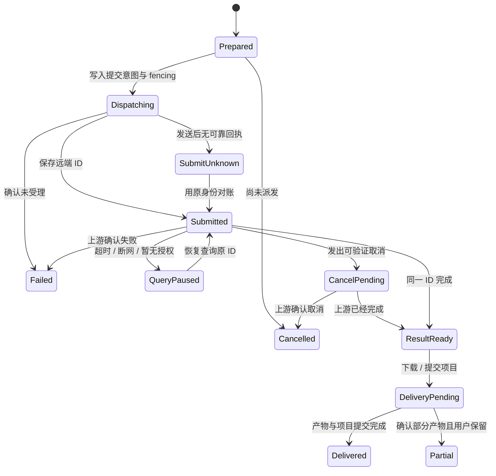

# 生图、生视频模型适配：审查与实施设计

2026-11-19 更新。Kling 4.0、Replicate 试点、Magpie 目录与文本预算、逐模型媒体限制和原任务恢复已实施。本文保留实施前审查与长期设计，并在末尾记录实际交付和验收边界。逐项证据见[80 项比较](./2026-11-18-media-model-compatibility-research.md)。连接接管和秘密迁移沿用[外部管理专项](./2026-11-18-external-provider-management.md)。

**建议：在现有平台加上「版本化模型清单 → 受限协议族 → 固定合同的耐久作业」。** 已知协议族可自动加入大量模型；只有名称的模型作为候选出现，无法确认的操作由用户选模板。新鉴权或新任务协议只新增一个有夹具的适配器。OpenAI 兼容、Kling 新版、fal 队列、Replicate Prediction、ComfyUI 工作流是不同协议族；模型营销名、产品入口与厂商身份都不能代替协议标签。

## 实施前代码审查

| 优先级 | 位置 | 触发条件及影响 | 修复与验收 |
|---|---|---|---|
| P1 | [Kling 查询检查](../../src/services/ai/providers/klingImageResponse.ts#L15)、[结果选择](../../src/services/ai/providerCatalogService.ts#L137) | HTTP 200、业务码 0，首条任务有状态但不是原 ID。当前先信任 `data[0]`，可把其他任务的成功产物或失败状态记在原节点。任意非空未知状态也会被当作未结束继续等待。官方返回数组、任务 ID 和四个明确状态。 | 单任务查询严格要求唯一匹配预期 ID，同一行取状态与结果；空、错 ID、重复 ID 和未知状态进入可恢复的合同异常。覆盖首次查询、旧回执、画布和角色恢复；错误结果 0 次回填、0 次重投。 |
| P1 | [参考图合并与替换](../../src/services/ai/generateImage.ts#L491)、[编号来源](../../src/services/ai/promptResolver.ts#L205) | 提示里的 `图片1` 先按解析引用编号，显式输入或风格母图随后可插入数组前面，再直接把提示文本中的编号改写成 `@image1`。例如只有一个角色引用时添加项目母图，角色原编号仍可能指向现在排首位的母图。手写同名词也被正则改写。 | 保存绑定 ID/角色，找出最终媒体顺序后一次渲染供应商别名。用两张不相似的引用、样式图、去重、手写「图片1」以及组合输入夹具检查实际请求。 |
| P2 | [Kling 合同判断](../../src/services/ai/providerCatalogService.ts#L159)、[已知产物数](../../src/services/ai/mediaModelCapabilities.ts#L482) | 仅改查询间隔或退避，整份协议比较即不相等。请求路径仍可能有效，但固定组图数量、参考图转换和业务码校验依赖该判断，行为会漂移。比较函数解析失败返回 `undefined`，也不应允许两个失败结果视为同合同。 | 协议族与合同摘要作为明确身份；查询策略独立配置。已有保存的有效内置协议迁移时核对规范化主体，无法识别的一律自定义，不走原生钩子。 |
| P2 | [目录合并](../../src/services/ai/providerCatalogService.ts#L912)、[目录长度读取](../../src/services/ai/providerCatalogService.ts#L775) | 同 ID 的远端项可以改类别，却保留原类别执行协议、能力或默认值。有限小数、负数和未知操作也可能进入能力对象。声明覆盖局部字段后可形成不自洽的列表、范围、默认值。后续校验可能阻止使用，不能把这些项视为已适配。 | 校验来源、类别和操作身份；在发布快照前校验整组字段，数组与范围按明确优先规则原子更新。不合法变更保留最后可用值并展示诊断。 |
| P2 | [Kling 数量声明](../../src/services/ai/providerCatalogService.ts#L125) | 组图实现固定 10；官方支持 2–10 和 `auto`。可提交数量、作业数、生成数量目前挤在固定值或 `maxBatchCount`；可变结果缺少表达。 | 设 `jobCount`、`outputsPerJob`、`seriesAmount`，按合同验收精确/范围/自动，部分结果只进入待核查或部分交付。长图使用独立提交操作。 |
| P2 | [通用视频校验](../../src/services/ai/generateVideo.ts#L878)、[视频长度](../../src/services/ai/videoRequestResolver.ts#L932) | 新上限属于通用能力，存在绕过通用入口的历史分支。若把「设置了视频上限」宣传为所有节点均已生效，会高估覆盖。对模型专有模式、分辨率等条件也不能只用一个长度上限。 | 建立全部生成入口清单，逐个走同一最终参数检查或标记「旧入口/未验证」；同一请求适配过程中的最终发包参数才是计量依据。 |
| P3 | [图片长度](../../src/services/ai/imagePromptLimits.ts#L24)、[请求预构建](../../src/services/ai/modelProtocolRuntime.ts#L477)、[实际构建](../../src/services/ai/modelProtocol.ts#L146) | Unicode 计数创建数组，视频即使无上限也计数；协议识别反复解析与排序；提交预检和真实提交分别构建请求，可能重复序列化大正文。 | 用代表性 trace 先测，逐个去掉热路径分配。大素材关注峰值和桥接复制，协议编译移出操作热路径；保持请求身份与取消约束。 |

这些是实施前从源码推导的触发路径，未运行应用复现。进度以下方阶段表为准。可复用资产包括模型目录、媒体 Registry、声明式执行和现有作业存储。查询有限重试、结果落项目、失败和暂停的区分应保留。现有「原生项目任务」记录由 IndexedDB 管理。见 [模型目录](../../src/services/ai/providerCatalogService.ts)、[媒体 Registry](../../src/services/ai/mediaProviderRegistry.ts)、[声明式执行](../../src/services/ai/modelProtocolRuntime.ts) 和 [现有作业存储](../../src/services/indexedDb/nativeMediaTaskRepository.ts)。

Kling 的一手资料：[公开文档入口](https://www.klingai.com/document-api/guides/get-started/overview)、[图片 API](https://klingai.com/document-api/api/image/4-0/image-generation.md)、[鉴权](https://klingai.com/document-api/api/get-started/authentication.md)、[长图](https://klingai.com/document-api/api/image/4-0/long-image-generation.md)、[4.0 文生视频](https://klingai.com/document-api/api/video/4-0/text-to-video.md)。普通图 `n` 1–9，组图 2–10 或 `auto`，英文/非英文混合限额为 50,000/21,000 的加权预算。ASCII 拆分是本地近似，应在界面和夹具注明，官方未给出所有 Unicode 分类。文生视频 3–30 整秒是该操作合同，不能外推其他版本或代理。官方支持按唯一 `external_task_id` 对账；资料未证明同 ID 重放提交一定不新建或不计费。该鉴权页展示北京新系统地址；工作区默认的新加坡入口要用对应地区的正式资料和账户联合验收，不从客户端常量推断已联通。

## 选择与边界

| 路线 | 自动化 | 生命周期与风险 | 选择 |
|---|---|---|---|
| 每模型写分支 | 每个新 SKU 要发版 | 重复校验、难统一恢复，适合修旧特例 | 保留作迁移桥。 |
| 从名称或示例自动猜测 / 重试试探 | 初看很快 | 找不到正式约束；探测可付费，输入与路由可能猜错 | 仅作为待验证候选提示。 |
| 全部交给一个网关 | 同网关接入快 | 依赖供应商；付费语义、私有上传和工作流仍不同 | 支持网关作为连接，不设为必经层。 |
| 版本化清单 + 协议族 + 耐久运行时 | 同族且 schema 完整，免改编排代码；新协议增一个受控适配器 | 编译时校验，分阶段迁移，未知能力可以解释和诊断 | 采用。上游类比见证据 A05–A07、B01、B08–B09、C07、D01–D03、D11。 |

### 如何自动选择不同适配

1. **发现。** 只读拉取已配置 origin 的目录，支持分页、响应体上限、ETag、本地 TTL 和上次成功快照。已知厂商清单、已注册协议族且来源受控的 OpenAPI/schema、用户导入的无密钥清单分别识别来源。按 `connectionId + vendorModelId + operationId` 建键；同名模型不合并。错误目录不自动改分类或连接。未知私有 schema 先预览映射，不由软件隐式发探测生成。
2. **发布合同。** 每个操作保存 `manifestVersion, adapterId, adapterVersion, capabilityRevision, evidence, inputSchema, outputSchema, lifecycle`。编译已注册模板为不可变执行计划，原子发布。路径、鉴权、秘密、能否执行、媒体目的地和最大预算属于本地受信策略；远端目录不得扩大。已知硬限额和平台预算取交集；远端可信枚举可限制已知范围，用户偏好只能在允许值内改默认值。冲突依整条操作隔离，保留最后可用版与来源。缺乏可靠上限时标为未知，保持本地安全预算，并可由明确的用户配置建立一个独立兼容合同。
3. **决策。** 已核实同族且必需字段齐：自动适配，可见来源和版本。同族但仅列出模型名：以已知公共基线展示已证实操作，其余保持「未验证」。未知模型/新端点：选择模板、预览脱敏请求，先做本地 fixture 或允许的只读探测；付费验证由用户明确发起。未知协议需人工集成或经受信插件注册。编辑参数、切换连接、对话 @ 模型均走同一解析逻辑。
4. **执行。** 公共接口只收 `prepare / submit / query / fetchOutputs / cancel / reconcile`；后四项按合同可选。由协议族声明支持的阶段、状态、错误分类、查询副作用和响应身份路径。只允许纯的字段选择、常量、白名单函数和限量循环；禁止任意 JS、外部 schema 递归跨域加载、任意 Header 和 origin 改写。已知的签名、私有上传或大型流式传输交给受审的原生族接口。
5. **验证。** 共享表单、预览和提交校验同一份规范化能力树。时长用整数刻度或枚举，范围使用 `min/max/step`，可依操作、分辨率、FPS、参考输入调整。保留长度单位（码点、字节、token、加权计数）和约束阶段。测量引用、项目附加提示与协议渲染之后的最终文本，单独校验负面提示、分镜文本、请求体、引用单项/合计体积和结果数；严禁把这些预算互相替代。候选模型的最大值来自公开合同，未公开能力不猜。时长超能力时给出可选档位或「分段生成并拼接」的显式计划，展示质量、音轨和费用变化。

Kling 的普通图、组图、长图、标准版文生视频与多关键帧，以及 Flash 文生视频与单首帧各自声明提交路径和能力，共享 `kling-tasks-v1` 查询合同。旧组图 ID 继续固定 10 张，手选 2–10 张和自动组图各有独立 ID。LibAPI 同名模型沿用 LibAPI 的协议。Replicate 的两款 FLUX 和两款 Veo 共用 Prediction 流程。Flash 全能参考还需要为首帧、普通参考图、特征视频、底视频和主体建立独立角色映射。主体库及通过外部 ID 对账仍属后续设计。[Flash 文生视频](https://klingai.com/document-api/api/video/4-0-flash/text-to-video.md) · [Flash 首帧生视频](https://klingai.com/document-api/api/video/4-0-flash/image-to-video.md) · [Flash 全能参考](https://klingai.com/document-api/api/video/4-0-flash/video-omni.md)

### 模型列表、长度来源与设置

CC Switch 和 Magpie 给出互补做法。一个把发现列表和参数补全拆开，另一个把用户设置、上游目录和运行时路由接通。Canvas 采用共同的能力解析，优先利用当前连接可核实的能力。源码、提交与差异见[两项目对照](./2026-11-18-media-model-compatibility-research.md#补充源码对照--cc-switch-与-magpie)。

| 现有入口 | 本轮静态核对 | 需改变的行为 |
|---|---|---|
| [目录解析](../../src/services/ai/providerCatalogService.ts#L855)、[目录地址](../../src/services/ai/providerCatalogService.ts#L991) | 通用解析读取图像、视频的部分限制，未取文本上下文和输出字段。Magpie 的媒体条目用 `kind`，其通用 `type` 可是 `model`。目前目录请求也没有为已识别的 Magpie 加上媒体筛选参数。 | 先在显式选择 Magpie 的连接解析 `kind`、`modalities` 和文本长度字段，按需请求 `?kind=all`。保持线上模型 ID 原样。普通 OpenAI 兼容连接继续按其自身合同解析。 |
| [手动输入](../../src/components/settings/ProviderConnectionDialog.tsx#L683)、[表单合并](../../src/components/settings/providerConnection/providerConnectionModels.ts#L28)、[配置同步](../../src/store/store.config.ts#L137)、[导入](../../src/services/ai/providerConnectionTransfer.ts#L142) | 文本只有一个 `contextWindow` 槽。合并有传入值时可替换原值，传入缺字段时可继承旧值。同步使用 `model.contextWindow ?? existing?.contextWindow`。因此同槽新增远端值会导致部分人填字段被刷新覆盖，清空后的值也可能从旧运行配置带回。 | 目录能力、用户覆盖、投影配置分别存储。已保存的旧值按兼容覆盖迁入，恢复自动由删除覆盖表达。刷新不读写覆盖。 |
| [文本预算](../../src/components/nodes/shared/defaultModels.ts#L1336)、[上下文组装](../../src/services/chat/contextManager.ts#L371)、[助手发送](../../src/services/ai/assistantStream.ts#L337) | 本地按配置、模型 ID 及 32,000 回退求窗口，再估算输出预留。入口组装和真正发送可能使用不同阶段的数据，视觉内容和工具定义在发送前才装入。 | 预览可估算。实际发包用同一轮固定的连接和合同，计入最终工具定义、消息、附件及协议额外开销。 |
| [文本请求构建](../../src/services/ai/chatApiProtocol.ts#L132)、[Responses](../../src/services/ai/responsesApiProtocol.ts#L26) | 原生 Anthropic 当前固定请求 4,096 输出。通用 Chat Completions、Responses 和 Gemini 构建器未将上述输出预留同步到实际请求。另有声明式和特殊传输。 | 设置页分别显示“模型公布上限”和“本轮请求上限”。由协议绑定发送字段。现有固定值及依赖上游默认的路径在接入时保留兼容兜底。 |

**发现与写入。** 已配置连接通过自己的目录确认可见模型。已注册的目录解释器负责字段语义和协议候选，不授予执行新操作、访问新地址或上传素材的权限。同一字段依次检查连接及操作的已核实约束、账号目录的有效声明、同部署预设及经确认的用户配置。公共目录按规范化地址或显式映射补全候选，纯同名只提示。硬约束均参与校验。用户可以将执行预算调低，或为缺失的字段录入带来源的手动声明。已知硬限额更低时保留编辑值并提示实际受限。用户偏好与来源冲突时显示生效值及依据。

保存以 `connectionId + modelId + operationId` 为键。路由别名与底层模型使用不同条目。能力字段带来源、单位、已核实/参考/未知状态和目录修订。对同一个连接修订、凭据身份、目录协议及查询范围合并并发刷新。成功且完整的响应才可原子替换当前快照。分页失败、无响应体或格式无法判读时保留最后成功版并展示刷新状态。若该协议能确认目录完整且确实为空，可正常发布空快照。缺失项仅在已证实完整的范围内标记“当前不可用”，保留收藏、草稿和已选设置。应用结果前校验连接代次与请求序号，阻止晚到响应污染切换后的连接。用户覆盖与刷新分别提交，遇已修改的表单也无需锁住用户操作。

**长度与发包。** 文本分别保存 `totalContextTokens`、`maxInputTokens`、`maxOutputTokens` 和可选的默认输出请求量。窗口语义不明的网关值可作为保守的共享预算参考，界面注明“网关声明”。Magpie 的三个窗口别名折为一个来源。只有文档明确具有独立语义的输入和总长度字段才分别入库。真实已知约束用以下规则联合校验：

- 输出请求量按用户所选档位或建议值确定，同时受已核实输出上限、协议字段能力和平台预算限制。缺失输出上限显示“未知”，预留量仍由本地策略给出。支持显式限输出的协议使用该值。如果协议必须委托上游默认，界面将本地预留标为估算。
- 输入先受独立输入限额约束。若另有已核实的共享总窗口，再限制为 `总窗口 − 请求输出量`。扣除无法精确计量时的保守余量，随后对实际装配的系统消息、附件、工具定义和完整工具往返做检查。余量随可用计数器、模态和协议调整，不能在构建请求后再追加不计量内容。若最小必要内容已超限，给出减少附件、调低输出或切换模型的选项。
- 输出字段按已核实的协议变体映射。OpenAI 风格 Chat 端点按实际能力选 `max_completion_tokens` 或 `max_tokens`。Responses 用 `max_output_tokens`，Anthropic 用 `max_tokens`，Gemini 用 `generationConfig.maxOutputTokens`。声明式和网页桥逐个验收。上游拒绝后将反馈关联到本连接与协议，不从单次失败改写公开目录或自动重复付费。
- 媒体长度继续按各操作以码点、字节、加权字符、秒或枚举表达。输入和输出素材分项计量。目录只有 `kind` 或模态时展示已发现模型与待核实参数。Kling 官方、转接站及 Magpie 的同名模型分别绑定各自合同。扩大上限以操作合同及真实提交夹具为依据。

**路由和续聊。** 若能核实一个组的所有备选成员及规则，自动重选的共同预算取可用成员的约束交集。成员及上限未能核实时，采用协议的保守预算，界面同时显示组公布值和“当前预算为估算”。公布 1M 的组若包含 128K 候选，默认全成员预算至多按 128K 约束计算。锁定已核实的 1M 成员后，才按 1M 对应合同重新装配。若未来网关提供有时效的预选回执，可以在得到绑定结果后放宽本轮预算。普通路由观察事件只用于解释网关实际选择。

每轮开始固定模型、账户、协议、目录修订及预算，完成该轮工具往返，刷新在下一轮生效。换模型时保留原始会话，从摘要和近期完整轮次重组。供应商原生续聊 ID 和原生推理状态只在同一合同可继续。上游报告超限或截断后保留已有正文与工具执行记录，从尚未派发的阶段继续，避免已经执行的工具和媒体作业重跑。旧作业按原网关地址、账户绑定、合同及不透明任务 ID 查询。网关换路由或目录下线只影响新任务。若原账户或端点无法确认，暂停并保留回执。

设置操作顺序为「拉取模型 → 启用 → 查看有效值和来源」。常规路径默认启用自动值，高级区域可编辑、试算及逐字段恢复自动。切换会话模型时只列对本轮有影响的变化，例如输出减少或附件不再支持。目录刷新只读。模型试跑与媒体重生成单独显示请求和计费语义。

### 多轮与重试交互

对话保持用户写的原文、媒体引用、变体树和项目关系。发起时冻结该次请求的文本、引用角色、能力/价格估计和可选的上游会话 ID。上一结果卡可「作为参考继续」；若该模型支持继续或延展原作，就显示「继续原作」并使用同连接父任务，其余以项目中已落盘的资产新建请求。切换模型保留草稿，换用本地可共享素材，模型专有选项留在各自草稿；标出未支持或需改动的字段，不静默裁剪或替换信号。原始提示完整保留，超限给出消耗明细和可撤销预览。

任务卡区分「继续查询」「重新下载」「打开原平台核对」「取消远端任务」「用相同设置再生成」。前两项按原回执恢复，第三项用于未知提交，第四项在上游明确支持时提供，新生成展示计费后果并产生独立 `operationId`。关窗口可以停止本窗口等待；关应用后仅承诺续查已有持久回执。进度不明显示接收、排队、生成等真实状态，禁止虚构百分比。结果可到达已切离的项目，但不能覆盖用户后来修改的目标。

## 作业生命周期、线性顺序和故障处理

- **固定身份。** 提交记录固定 `operationId, connectionId, origin, providerAccountBinding, adapterId/version, contractHash, requestHash, project/target/revision, externalTaskId, remoteTaskId, revision/fence`。驱动旧回执需要最小、有限的已编译合同及白名单上下文；只存 hash 无法恢复已删除的版本。保存单独的本地引用或任务关联，禁止持久化凭据、签名、未经约束的响应体。换账或重新绑定时要证明是同一身份；证明不了就暂停对账。
- **事务顺序。** 每个操作只有一个带 CAS 和栅栏令牌的写入者。持久化 `Dispatching` 后最多发出一次计费提交，服务器返回后先事务保存远端 ID 再查/送达。崩溃在两者之间可能未知：可用原外部 ID 对账；只有厂商明确保证相同键、相同正文、同一账户在有效期内幂等，才允许自动重发。租约过期不能将 `Dispatching` 自动改回 `Prepared`。迟到回执通过受控对账入口保存，旧租约不能更新 UI、重新派发或覆盖新状态。
- **查询。** 用单调时间计当前轮等待，分别限定每次请求、每轮轮询、持久化的重试次数和停机后继续资格。尊重 `Retry-After`，加入抖动，每个连接独立配额，持久化下次允许尝试的时间；连接恢复不打满队列。只对确认为只读的查询/取件重试，POST 查询也需合同证明没有副作用。区分传输未发、超时未知、认证失败、业务码、远端终态和完成但缺产物。传输忽略取消时仍占用 in-flight 预算，旧完成由 fence 丢弃。回调或 WebSocket 只是唤醒提示，默认按原任务续查；没有自带公网回调要求。
- **交付。** 产物键为 `operationId + outputSlot`，先写受限临时文件、校验媒体类型和大小及摘要，再写到项目资产位置。文件与记录不能横跨两套存储伪装成原子事务：用可恢复的交付意图，重复交付同槽/相同内容时复用，槽已绑定不同内容或项目版本冲突时留待处理。确认所有必须的槽和项目已写才标 `Delivered`。过期链接先查原结果；超出平台保留期后明确失败边界。
- **资源回收。** 每一个上传、下载、取消令牌、文件句柄、队列占位和归档等待都有负责的阶段。丢失窗口不丢回执；取消或进程重启释放本地资源，下一次运行清理过期租约和孤儿临时文件。审计只记录匿名操作关联、适配版本、阶段耗时、计数和错误类别。

本机可以保证同一作业记录的条件写入顺序和项目交付去重。远端超时后是否已计费、用户终止是否能打断执行，要按上游回执判定；无法从本地单方面保证跨网络恰好执行一次。遇到任务过期或永久失去授权，保留可解释的只读记录。

## 安全与性能验收

网络只用连接授权的来源。发现和运行的 URL 在原生边界分别校验协议、主机、端口、重定向和允许网络范围；媒体 CDN 单独授权，禁止转发 API Key。远端账户来源、读权限与上传目的地分别授权。项目素材用带项目作用域和有效期的句柄，向第三方图床转发需要明确规则，不由远端清单决定。解析层限制响应、字段深度、数组、资产数量和实体大小；记录和报错不得带 API Key、签名 URL 或完整正文。核查恶意目录、权限撤销、跨项目与跨源请求被拒。凭据供执行时读取，不放在运行计划快照里。

下面是**试点门槛草案，未实测**。首轮在可复现的相同桌面、设备和样本采基线，再冻结门槛。React/WebView、协议 JSON、TLS 和 Tauri IPC 都可能分配，不能承诺整个软件 0 GC 或无缺陷。Rust 热路径没有语言级追踪式 GC，但仍需测分配次数与析构开销。

| 维度 | 量法与初始门槛 |
|---|---|
| 合同快照热路径 | 固定 2,000 个模型/操作，预编译后重复选取 10,000 次。原生查找与纯状态判定以稳态 0 额外堆分配为目标，原生寻址 p99 ≤ 1 ms；不计冷启动和真实网络。只在测出 JavaScript 有必要且瓶颈可归属时迁原生。 |
| 输入与交互 | 20 个活跃作业时对 50,000 码点草稿输入、切模型、查看任务。p95 点击到反馈 ≤ 100 ms，单次本地解析开销 p95 ≤ 8 ms；检查滚动和键入期间有无新增长于 50 ms 的主线程任务。上游网络等待单列。 |
| 资产与背压 | 采用流或文件句柄，使用上限附近的图像和视频夹具测 RSS、IPC 字节与队列。原生流式路径目标每活动传输缓冲 ≤ 1 MiB、无整份素材 IPC 副本；强制 base64 合同单列预算与并发。默认为每连接 2 个查询、全局 8 个查询、2 个大文件传输，可按合同调低。 |
| 稳态和故障 | 100 个待查回执与断网恢复的压力：无双重提交、无重复项目产物、无过期 fence 写入；100 次暂停/继续/关窗后，每类资源计数回到基线，记录峰值/p95/p99/请求数。 |
| 合同与交互 | 覆盖正确 ID、错误 ID、未知状态、缺输出、部分交付、超限边界、Unicode、参考角色、同名跨连接、429/5xx、切项目、删除模型、换密钥、重启和回切。使用合同 fixtures、状态机性质测试、可控时间/故障注入、桌面试点；另以获得授权的最小付费调用验真实地区和账户。 |

## 实施次序、退出条件与回滚

| 阶段 | 改动范围与交付 | 门槛及回滚 |
|---|---|---|
| 0 · 先修风险 | 模拟回归已通过。Kling 按原 ID 匹配唯一状态和结果。编号跟随实际图片及关键帧顺序。 | 错 ID、重复 ID、未知状态和丢失查询响应保留原回执。角色工作台和原生画布覆盖删除模型、改连接、改凭据及摘要。 |
| 1 · 解析能力 | 已实现。已核实清单、账号目录和手工配置共用分类与能力解析。已配置的类别、协议和素材格式在刷新时成套保留。目录导入分组校验图片／视频提示词预算与视频时长。远端仅更新时长区间时，保留仍在区间内的已知离散档位，移除不再适用的旧默认值。 | 无效的新声明保留可用的回退能力，其他有效字段可独立刷新。回归覆盖矛盾区间、无交集、非法默认值、合法小数秒和 180 秒档位。完整 schema 编译器、细粒度字段证据及通用远程 schema 导入仍是独立扩展。 |
| 1a · 文本目录和设置 | Magpie 按连接保存目录能力和手动窗口。清空手动值恢复自动。切换连接身份会废弃旧刷新结果。 | 模拟目录与设置用例覆盖同名隔离、目录空值、刷新失败、取消和手动覆盖。 |
| 1b · 预算到发包 | Magpie Chat、Responses、Anthropic 使用对应输出字段。Agent 在一轮内固定连接、模型、能力、凭据和预算。 | 模拟发包与多轮测试覆盖工具和附件预算。其他文本协议及真实账户行为需各自核实。 |
| 2 · 耐久作业 | 声明式原生生成在发包前耐久记录未知提交。明确未受理进入失败，响应丢失保留待核对。已知任务按原连接、合同及 ID 继续查询。查询用单调时钟计时，同一轮等待中底层请求未释放时暂停。Replicate 的已知终态与同 ID 核验也覆盖旧回执。 | IndexedDB 和 HTTP 模拟已验证原任务只提交一次。全平台统一账本迁移、远端幂等对账及跨存储交付事务仍在长期设计范围。回滚时已知任务继续由原合同查询。 |
| 3 · 扩大覆盖 | Kling 长图、手选及自动组图、标准版和 Flash 视频已实现。Flash 的 720p、3–20 整秒和单首帧由画布和设置试跑共用。Replicate 以两款 FLUX 和两款 Veo 验证同协议族复用。LibAPI 更新已获取的提示词长度和时长。 | 模拟请求、响应及旧合同快照已验证。新增协议族以及真实地区和账户覆盖按各自合同验收。 |
| 4 · 交互与性能 | 设置、试跑和发包共用逐模型限制。Kling 已核实合同的提示词限制可收紧，时长取官方档位和连接设置的交集。设置支持恢复默认，目录刷新及重开以已保存的选择为准。内置协议提供只读预览和按操作展示素材的试跑。顺序组图以实际交付数量报完成。图片和视频计数去掉逐码点数组，声明式协议每次构建只渲染一次正文。 | 隔离 Edge 和 Windows Tauri 均通过设置与 Flash 原任务续查。Tauri 另通过普通生图和手选组图试跑。下表记录局部基准。全画布交付矩阵、I/O 背压、长期运行和 WebView 性能仍待实测。 |

### 提示词计数实测

Windows Node.js v24.19.0，每种文本 50,000 码点。预热后交替执行 `Array.from(text).length` 和源码扫描，各采 40 组，每组 20 次。表中 p50／p95 是各组单次平均耗时的分位值，单位毫秒。所有计数结果一致。

| 样本 | UTF-16 长度 | 旧方法 p50／p95 | 码点扫描 p50／p95 |
|---|---:|---:|---:|
| ASCII | 50,000 | 0.366／0.434 | 0.080／0.087 |
| 中文 | 50,000 | 0.443／0.791 | 0.088／0.146 |
| ASCII、中文和表情混合 | 75,000 | 0.563／0.861 | 0.180／0.234 |

这项基准只测计数函数。扫描不创建逐码点数组。另在同一 Node.js 版本运行本地轮询压力测试，30 批、每批 100 项，整批 p95 为 3.608 ms，结束后残留取消监听器为 0。期间观测到 11 次 GC，合计 4.242 ms。声明式请求构建基准使用 16,000 字符提示词和 10 个参考地址。预热后交替测量 60 组，每组 50 次。两版请求正文一致，每次构建的 p50／p95 从 0.142／0.223 ms 降到 0.097／0.176 ms。端到端交互、WebView 堆分配和 GC、上传下载峰值与队列吞吐需要独立测量。

Windows Tauri 使用 `npm.cmd run tauri dev -- --no-watch --no-default-features` 打开主窗口。用与本机 WebView2 匹配的 Edge WebDriver 连接隔离实例，使用临时应用标识、独立数据目录和回环 API。桌面验证了 15 个候选，Flash 提示词预算和时长的修改、无效值保留、恢复默认、保存重开和目录刷新。Flash 首帧以 12 秒、720p 提交一次，错 ID 的查询响应未交付结果，重开后继续查询原 ID 并取回产物。普通图和手选组图分别发包，均使用 8K、21:9 和 `image1` 参考图，核实普通图的 `n=2` 和手选组图的默认 `series_amount=2`，分别返回两张图。

画布首次重启验收发现，声明式原生媒体取得远端 ID 后，启动扫描未连接原任务查询，导致节点保持生成中。现按持久回执复用供 Kling、Replicate、xAI 使用的版本化查询合同。打开原画布优先交付本机产物，对具备原凭据证明的作业做最多 15 秒的自动查询。仍在处理时可手动续查，手动查询继续使用原合同的等待预算。节点操作结束后只恢复暂停入口，不因释放事件重复查询。旧回执缺少可验证身份时，退出等待并提示到原平台核对。自动及手动恢复均校验原画布、输入摘要、回执租约和原连接。

隔离 Tauri 复验了 Kling 普通图的三条路径。强制关闭应用后重开原项目，自动按原 ID 取回已完成的图。重启时原任务仍在生成，自动查询到时限后显示「继续查询 / 保存」，手动继续后取回原图。查询返回其他任务时同样暂停，恢复后只交付原任务图片。每次验收仅有一次生成提交。关闭测试 API 后重开画布，已交付图片仍可从本机文件解码。真实地区账户和其他操作的完整画布交付矩阵仍待验收。[桌面验收步骤](../模型与生成模块.md)

画布补验覆盖 Kling 自动组图、纯文本网页长图、Flash 文生视频和标准版文生视频。自动组图以 `series_amount: 'auto'` 提交，三个返回地址均被下载。网页长图发往专用端点，收到 `webpage` 和 `2k` 参数，产物在画布从本地解码。Flash 以 20 秒和 720p 提交，标准版以 30 秒和 1080p 提交，两次均按原任务 ID 取得结果，并在全屏预览解码本地 MP4。每个操作各记录一次生成提交。无参考素材的原生确认框已显示。视频夹具通过应用的生成服务入口验证提交到交付，原生确认按钮的点击仍待人工验收。

隔离 Edge 使用回环 API 夹具和模拟凭据。宽度 750 像素的视口可以通过键盘打开时长列表、移动焦点并选取合法秒数。Flash 首帧试跑发送一次 `POST`，采用已保存的 12 秒与 720p。查询响应缺少原任务时不交付其他任务的结果。关闭、重开试跑面板后继续查询，两次 `GET` 都绑定原任务 ID，最终返回该任务的产物。

默认特性的 `cargo check --locked --manifest-path src-tauri/Cargo.toml` 使用仓库打包脚本中的 Cargo 1.100 目录准备方法，通过 DirectML 复制和原生编译检查。画布恢复修复后重新运行 `cargo test --locked --manifest-path src-tauri/Cargo.toml --no-default-features --lib proxy_http_tests`，18 项通过。

最终源码运行 `npm.cmd run ci`，通过 ESLint、应用和测试类型检查。Vitest 共 822 个文件、15,137 项通过，生产构建成功。
