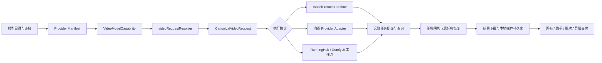

# 视频模型通用适配方案

初次调研日期为 **2026 年 11 月 26 日**。本文承接[媒体模型适配与恢复](./2026-11-18-media-model-compatibility.md)、[运行时与验收设计](./2026-11-18-provider-runtime-design.md)和[声明式视频输入校验](../adr/0008-declarative-video-input-validation.md)，用于规划 MAGI‑2 及其他视频模型的统一接入。Sand Ark／v2、Higgsfield、BeatAPI 和 Nereo 已登记独立的 MAGI‑2 接入合同，真实账户和桌面链路待验收。

## 1. 结论

AI Canvas 不应按营销型号增加分支。应把每个可执行能力登记为一个有来源、有版本、有生命周期合同的操作，再由协议族和内置适配器负责实际发包。

- **统一入口。** 画布、助手、批次和剪辑转场都产出同一份规范化视频请求，使用 `connectionId + modelId + operationId` 选择合同。
- **差异下沉。** 参数名称、参考角色、上传、鉴权、查询状态、结果路径和错误语义由合同或适配器保存，不散落在组件和模型名称判断中。
- **首期接入。** MAGI‑2 先接 Sand Ark。它能覆盖文生、普通参考和首尾帧，能复用项目已有的异步任务、媒体交付和恢复边界。
- **分级扩展。** 可由配置表达的合同进入声明式协议，涉及多步骤上传、签名刷新、特殊鉴权或非 JSON 任务的合同进入内置 adapter，RunningHub 和 ComfyUI 保留工作流适配器。
- **事实边界。** 官方公开能力、平台转接能力、项目现有实现和真实账号实测分开记录。只有通过对应合同夹具和桌面验收的操作才能显示为已验证。

## 2. 当前代码调用链

现有代码已经具备模型目录、能力声明、声明式协议、原生异步任务和媒体恢复。主要缺口集中在操作级角色、合同快照、上传编排和多个入口的参数一致性。



涉及的主要源码入口如下。

| 层 | 当前入口 | 需要延续的职责 |
| --- | --- | --- |
| 类型与能力 | `src/types/aiTypes.ts` | 跨厂商能力、参考媒体、任务回执和下载权限 |
| 规范化请求 | `src/services/ai/videoRequestResolver.ts` | 操作、输入模式、时长、比例、参考数量和提交前校验 |
| 统一生成 | `src/services/ai/generateVideo.ts` | 原生厂商、声明式协议、转接平台和结果回填 |
| 声明式协议 | `src/services/ai/modelProtocol*.ts` | 受限模板、请求、轮询、响应解析和预览 |
| 目录与策略 | `src/services/ai/providerCatalogService.ts`、`providerPolicies.ts` | 连接、模型清单、协议预设和来源策略 |
| 原生任务 | `src/services/nativeModelProtocolTask.ts`、`nativeProtocolRecovery.ts` | 发送意图、远端 ID、恢复和查询合同 |
| 结果交付 | `src/services/nativeMediaResultPersistence.ts` | 下载、校验、本地文件和历史记录 |
| 多入口运行时 | `src/services/ai/generationRuntime.ts`、`src/services/videoBatchPlanning.ts`、`src/services/videoEditorAiTransitionService.ts` | 助手、批次、剪辑和画布使用同一合同 |
| 工作流 | `src/services/ai/providers/runninghub*.ts`、`src/services/comfy*.ts` | 参数映射、队列、节点输出和工作流专属恢复 |

### 当前能力与缺口

`VideoModelCapability` 已能表达操作、输入模式、分辨率、比例、帧率、离散或范围时长、音频、参考数量和部分输入约束。`VideoGenerationOperation` 当前包含 `text-to-video`、`image-to-video`、`video-to-video`，`VideoGenerationInputMode` 当前包含 `text`、`keyframe`、`reference`、`mixed`。

| 现有表达 | 可继续复用的场景 | 需要补充的语义 |
| --- | --- | --- |
| `operations`、`inputModeCapabilities` | 文生、首帧、普通参考和视频到视频 | 编辑、续写、插帧、首尾帧、全能参考应成为操作或角色组合的明确合同 |
| `ratios`、`durations`、`minDuration`、`maxDuration` | Kling、Seedance、MAGI‑2 Ark 等常规参数 | 分辨率、比例、时长、帧率和音频的条件组合，不能只用模型级范围 |
| `MediaReferenceRole` | `reference`、`first_frame`、`last_frame`、`reference_audio` | 角色是否必填、是否互斥、顺序是否有意义、同一媒体是否允许重复 |
| `inputConstraints` | 提示词、Base64、参考视频和音频元数据 | 字节、码点、token、加权字符、容器和累计时长等单位要带来源 |
| `modelProtocol` | JSON、表单、multipart、异步查询和 URL 结果 | 多步骤资产上传、签名刷新、OAuth、SSE、WebSocket、非 JSON 任务和特殊取消 |
| `MediaTaskReceipt` | 远端任务 ID、查询、下载和恢复 | 保存完整的合同摘要、地区、水印策略、上传资产和结果身份 |

新增字段应保持可选，旧配置仍能读取。正式实现前先扩展规范化合同，再把旧分支投影到新合同，避免直接把业务组件改成按新字段判断。

## 3. 统一模型身份与操作合同

一个可执行条目由以下稳定身份组成。

```text
connectionId
vendorId
modelId
operationId
protocolFamily
manifestVersion
capabilityRevision
```

同名的 `magi-2`、`veo-3.1` 或 `wan-3.0` 不能合并。Sand 国际站、Sand 中国站、Higgsfield、BeatAPI 和其他中转平台都需要独立连接与合同。目录刷新不得改写已提交任务的合同。

### 操作分类

| 操作 | 统一输入 | 典型差异 |
| --- | --- | --- |
| `generate` | 文本、可选参考媒体、条件参数 | 文本是否必填，是否允许纯音频或空提示词 |
| `keyframe-to-video` | 首帧、可选尾帧、文本 | 尾帧字段、帧顺序、是否允许普通参考混用 |
| `reference-to-video` | 有序图／视频／音频角色、文本 | 每种角色上限、重复引用、文本与参考的组合 |
| `edit-video` | 底视频、编辑提示、可选参考 | 编辑模式、蒙版、片段或镜头时间线 |
| `extend-video` | 已有视频、续写提示、目标时长 | 原视频来源、续写时长、音频连续性 |
| `interpolate` | 首尾或多帧、插值参数 | 中间帧数量、固定帧率、结果时长 |
| `workflow` | 工作流 ID、参数和输入资产 | 节点输入名、输出选择、队列和专属状态 |

操作名称是本地稳定语义。上游字段名由映射层决定。模型只公开一个文生接口时可以只登记 `generate`，不能因为模型名称包含 `image-to-video` 就推断它支持首帧、尾帧或普通参考。

### 规范化输入

规范化请求至少包含以下内容。

```json
{
  "connectionId": "sand-cn",
  "vendorId": "sand-ai",
  "modelId": "magi-2",
  "operationId": "reference-to-video",
  "prompt": "镜头沿海岸缓慢推进，海浪逐渐盖过礁石。",
  "references": [
    {"kind": "image", "role": "first_frame", "sourceUrl": "asset://101"},
    {"kind": "image", "role": "last_frame", "sourceUrl": "asset://102"}
  ],
  "parameters": {
    "durationSeconds": 5,
    "aspectRatio": "16:9",
    "resolution": "1080p",
    "generateAudio": false
  },
  "submission": {
    "manifestVersion": 1,
    "capabilityRevision": "sand-cn-magi-2-ark-2026-11-26",
    "source": "official-documentation"
  }
}
```

提交前把 `references` 编译成有序的角色序列。适配器不得从数组位置推断角色，也不得在适配器中静默丢弃未支持的角色。缺少必填角色、角色互斥或条件参数不一致时在本地终止。

### 能力来源与生效规则

能力字段都应带 `source`、`sourceUrl`、`observedAt`、`confidence` 和单位。来源按以下优先级合并。

1. 内置厂商 manifest 的明确合同。
2. 已配置连接返回的目录或同一部署的版本化 schema。
3. 用户导入的无密钥模型清单或带来源的手动覆盖。
4. 仅有营销名称、体验页或转接平台宣传的候选信息。

远端声明不能扩大本地允许的主机、鉴权、上传范围、费用预算和安全策略。用户可以收紧限制。没有证据的字段保持未知，界面显示为待验证，不自动开放结构化控件。

### 生命周期统一语义

所有异步模型都映射到内部状态。

| 内部状态 | 进入条件 | 允许动作 |
| --- | --- | --- |
| `prepared` | 输入通过本地合同校验 | 提交或取消 |
| `submitting` | 已保存意图，正在发起创建 | 等待一次响应，超时转未知 |
| `submitted` | 获得可验证远端 ID | 有界查询、用户暂停、合同允许时取消 |
| `unknown-submission` | 超时、断流或 5xx 未知是否创建 | 只按可证明身份续查，不自动重投 |
| `running` | 查询返回处理中状态 | 按合同轮询 |
| `succeeded` | 任务 ID 与结果身份匹配 | 下载、校验、持久化 |
| `failed` | 上游明确失败或本地合同错误 | 展示错误，不重投 |
| `expired` | 上游明确过期或结果失效 | 按合同刷新或结束 |
| `cancelled` | 本地或上游明确取消 | 释放上传资产和本地租约 |

提交意图必须先落盘。创建超时、5xx、网络中断时保留 `unknown-submission`，不能凭空再发一次可能计费的创建请求。查询必须绑定原 `connectionId`、原远端 ID、原合同摘要和原任务上下文。

## 4. 模型和协议合同矩阵

下表把“项目已实现”“官方公开”“样例或待验”分开。公开合同只代表资料可读，不代表当前应用已接线或真实账户可用。

| 模型或协议 | 典型操作和输入 | 传输与生命周期 | 关键异化 | AI Canvas 路径与状态 |
| --- | --- | --- | --- | --- |
| Sand MAGI‑2 Ark | 文生、普通参考、首帧、首尾帧，图／视频／音频有序角色 | Bearer，`POST` 创建，按 ID `GET` 查询，结果为 `content.video_url` | 国际／中国主机不同，水印字段按地区不同，空文本、`asset://`、15,000 码点、4–30 秒和六种比例 | 首期内置 Sand Ark adapter，官方合同已查，代码与真实账号待实施和验收 |
| Sand MAGI‑2 原生 v2 | 文生、普通参考，`parts` 保持顺序，公开素材结构禁用 `role` | `POST /v2/generations` 返回 202，`GET /v2/generations/{id}`，结果为 `output.videoUrl` | 文本始终必填，字段采用 camelCase，错误可能带 `details.generation_id`，国际站省略水印 | 两地已实现，组合边界待实测，首尾帧使用 Ark |
| 火山 Seedance | 文生、首帧、多帧、全能参考、编辑或续写取决于版本 | 原生任务创建与查询，部分参考需要 TOS 或专用上传 | `omni_reference_task_type` 区分 reference、edit、extend，`watermark`、`adaptive` 和 `-1` 属于火山合同 | 项目已有部分原生和私有 TOS 路径，扩展按版本 manifest，不能复用 Sand 字段 |
| Kling 4.0 / Flash | 文生、首帧、全能参考、多关键帧、视频参考 | 异步任务，按唯一任务 ID 查询，部分接口有业务码 | Flash 文生 3–20 秒，标准版及其他操作参数不同，普通参考、主体、底视频和关键帧角色不同 | 项目已有 Kling 图像和视频试点，继续拆分操作合同，完整多参仍需逐操作验收 |
| MiniMax H3 | 文生、图生、视频参考取决于 H3 版本 | `/v2/video_generation` 创建，`task_id` 查询，文件或下载地址另有合同 | 模型名、查询字段、文件生命周期和输出字段与旧版接口不同 | 项目已有 MiniMax 供应商专项和模型清单，按官方 v2 独立 manifest，旧版不能自动继承 |
| Google Veo / Vertex AI | 文生、首帧、参考图、延长能力取决于 Vertex SKU | 长任务或长轮询 operation，区域、项目和云凭据参与身份 | Gemini API 的 Veo Preview 入口与 Vertex AI 不是同一合同，结果地址、区域和凭据边界不同 | Vertex 与 Replicate 路由分开，Gemini API 关闭或不可用时不能回退猜测 |
| Replicate Veo 及其他模型 | 文生、图生和视频操作由模型版本决定 | Prediction 创建、轮询、同步等待或 webhook | 版本 ID、输入 schema、结果数组、文件 URL 过期和 webhook 语义由模型版本决定 | 项目已有 Replicate Prediction 试点，通用 adapter 只负责 Prediction 生命周期，输入仍按模型版本合同 |
| Alibaba Wan 2.7 / 渠道 Wan 3.0 | 文生、图生、参考视频等由部署和接口决定 | 阿里原生异步任务、DashScope 风格查询，或 APIMart / ToAPIs 转接 | 官方页面当前以 Wan 2.7 为主，渠道目录可能使用其他版本；地区、异步头、素材地址和输出结构均不同 | 项目已有 APIMart、ToAPIs manifest 候选，阿里原生与中转连接分开登记 |
| xAI Grok Imagine Video | 文生、单图生视频、编辑、延长和参考操作取决于公开版本 | 厂商任务创建与查询，任务 ID 和结果字段随版本变化 | 当前项目已有文生和单图生视频路径，参考、编辑和延长不能由名称推断 | 已有 xAI manifest 和部分运行路径，新增操作须补正式 schema、错误夹具和桌面验收 |
| Runway | 文生、图生、视频编辑和上传素材 | 上传文件后创建任务，异步查询和结果下载 | Upload 资源、任务端点、模型版本、比例和时长是独立字段 | 作为原生视频协议族，适合内置 adapter，声明式协议只覆盖确认过的简单路径 |
| OpenRouter Video API | 由目录模型和 provider 路由决定的文生、图生、首尾帧和音频能力 | `POST /api/v1/videos`，`GET /api/v1/videos/{jobId}`，结果可下载或读取 `/content` | 模型能力和价格随实际 provider 改变，支持 `provider.order`、`only`、`ignore` 与 passthrough | 当前没有专用视频 provider，适合新增 OpenRouter adapter，不能把它当作某个厂商直连 |
| fal.ai Queue | endpoint 级模型推理，输入 schema 由模型 OpenAPI 决定 | `IN_QUEUE`、`IN_PROGRESS`、`COMPLETED`，支持状态、结果、取消和 webhook | 每个 endpoint 的字段和输出独立，队列协议统一但模型合同不统一 | 当前没有 fal adapter，适合先接通 Queue 生命周期，再按 endpoint manifest 加模型 |
| Amazon Bedrock Nova Reel | 云任务生成视频，结果写入指定 S3 | `StartAsyncInvoke` 返回 `invocationArn`，通过 Bedrock 查询，产物落在用户 S3 | 认证、区域、IAM、S3 输出位置和对象清单参与任务身份，不返回普通临时视频 URL | 当前未接入，需单独的云任务和对象存储 adapter |
| Azure Sora 2 / Foundry | Azure 托管的异步视频任务 | 创建返回 `status_url`，通过 Azure `/openai/v1/video/generations/jobs/{job_id}` 查询 | Azure endpoint、区域、部署名和 API 版本参与合同，不能与 OpenAI 或第三方 Sora 代理合并 | 当前未接入，需独立 Azure adapter 和部署配置 |
| OpenAI Sora 2 API | 官方 Sora 2 视频 API | 官方 Videos API 和 `/v1/videos` 已在 2026 年 9 月 24 日关闭 | 官方 API 生命周期已经结束，不能作为新直连入口；Azure Sora 2 Preview 和第三方 Sora2U 仍是独立合同 | 当前没有官方 OpenAI 视频直连，`Sora2U` 只能按第三方渠道登记 |
| Higgsfield MAGI‑2 | 文生、首帧、首尾帧，多参页面可能需登录 | `Authorization: Key`，`request_id`，`/requests/{id}/status`，`video.url` | 与 Sand 使用同名模型但输入字段、限额、定价和权限不同 | 独立连接和独立 adapter，公开文生与首尾帧可作为待验试点，多参保持未启用 |
| BeatAPI MAGI‑2 | 文生、关键帧、普通参考及可能的混合输入 | Bearer，`/v1/videos/tasks` 创建，`/v1/tasks/{id}` 查询 | 可选 24 小时 `Idempotency-Key`，比例和时长受其自身合同约束 | 用于验证同名模型的协议差异，作为转接平台合同，不并入 Sand |
| APIMart、ModelSell、Nereo、Muapi | 由平台公开的模型路由决定 | 各自 Bearer、`x-api-key`、任务查询和结果路径 | 上游版本、字段、额度和实际部署可能与宣传页不同 | 保留自定义连接候选，达到 schema、夹具和账号验收后再进入内置预设 |
| RunningHub | 云工作流中的视频模型、节点参数、上传和输出节点 | 工作流提交、队列、节点输出和平台任务恢复 | 模型不是唯一身份，工作流版本、节点输入名和输出选择才是合同 | 使用已有工作流 manifest 和 adapter，不伪装成厂商 REST 模型 |
| ComfyUI | 本地或远端工作流，支持任意节点组合 | prompt、队列、history、websocket 或轮询、输出文件 | 节点 schema、checkpoint、VAE、视频帧节点和输出文件绑定工作流版本 | 使用现有 ComfyUI 管理与可靠性层，工作流输入和输出独立验收 |

### 协议族分层

| 层级 | 适用合同 | 允许的内容 | 新增模型的成本 |
| --- | --- | --- | --- |
| 配置级 | 已确认的 JSON、form、multipart、同步或异步 REST | 字段映射、响应路径、状态枚举、结果 URL、有限轮询 | 新增 manifest 和夹具，不改业务编排 |
| 内置 adapter | 上传资产、签名刷新、特殊鉴权、多步骤任务、复杂结果、非标准取消 | 连接校验、准备、提交、查询、取消、结果解析、恢复 | 新增一个有版本的 adapter 和故障夹具 |
| 已安装工作流 | RunningHub、ComfyUI、本地脚本工作流 | 工作流版本、参数白名单、输入资产、输出选择和队列恢复 | 新增 workflow manifest，按工作流版本验收 |
| 新协议族 | OAuth、WebSocket、SSE、长 operation、非 JSON 或新的任务身份 | 新建受控运行时能力和安全策略 | 先完成协议设计、模拟服务、回滚和桌面验收，再发布模型预设 |

声明式模板只能访问受限变量、白名单字段和受控数组。它不能执行任意脚本、覆写鉴权头、改变请求源、动态读取外部 schema 或绕过本地费用与主机策略。任何超出范围的模型进入内置 adapter 或工作流层。

### 二次调研与协议分类

本轮复核了 Sand、OpenRouter、fal.ai、Runway、Alibaba Cloud Model Studio、Amazon Bedrock、Google Gemini／Vertex、xAI、MiniMax 和 Azure 公开资料，并对照当前项目的 manifest、provider policy、视频生成运行时、原生任务恢复和媒体 provider registry。公开文档页面在 **2026 年 11 月 26 日**可访问，不代表组织已开通模型、账户可计费或项目已完成真实调用。

视频模型接入应按“合同来源”分类，模型名称只能作为目录展示字段。

| 类型 | 代表入口 | 合同来源 | 统一层可复用内容 | 必须保留的差异 |
| --- | --- | --- | --- | --- |
| 官方直连 | Sand、xAI、MiniMax、Google Vertex／Gemini、Alibaba Wan、Runway、Azure Sora 2 | 厂商官方 endpoint、官方凭据、官方版本 | 规范化请求、状态机、任务回执、媒体下载和恢复 | 主机、区域、模型版本、素材上传、字段名、取消和结果生命周期 |
| 模型聚合 | OpenRouter、fal.ai、Replicate | 聚合平台目录、模型版本或 endpoint schema | 平台鉴权、提交、轮询、webhook、结果落盘 | 实际 provider、模型版本、输入 schema、价格、输出 URL 和 provider passthrough |
| 中转／代理 | APIMart、ToAPIs、LibAPI、RelayOnAPI、BeatAPI、Higgsfield、ModelSell、Nereo、Amam、Sora2U | 中转平台自己的 API 合同 | 通用异步任务、限流、错误脱敏和结果持久化 | 上游版本、字段映射、费用、额度、可用地区和是否支持混合输入 |
| 工作流平台 | RunningHub、ComfyUI | 工作流版本、节点 schema、队列和输出节点 | 工作流任务状态、资产输入、输出持久化和恢复 | 节点参数、模型文件、VAE、工作流 revision、输出选择和 websocket／history |
| 网页体验 | VidMuse、厂商 Playground 和模型体验页 | 浏览器会话、Credits、网页权限和内部接口 | 只能复用产品说明、能力发现和人工体验记录 | 不把网页会话冒充 API，不从页面字段推断稳定的开发者合同 |
| 云任务与对象存储 | Bedrock Nova Reel、部分 Azure／Vertex 长任务 | 云任务 ARN／operation、区域、IAM／部署和对象存储 | 云任务回执、轮询预算、产物清单和本地下载 | 结果不一定是临时 URL，可能是 S3 或云存储对象，需要单独交付流程 |

### 原生支持和兼容等级

“原生支持”在本文中指项目拥有该平台自己的连接、凭据边界、模型 manifest 和任务恢复合同。通过 OpenRouter、APIMart 或 ToAPIs 调用同一个模型名称属于渠道兼容，不能统计为厂商原生直连。

| 等级 | 定义 | 界面可见性 | 发布要求 |
| --- | --- | --- | --- |
| `L0` | 只有官网、体验页、目录或第三方宣传证据 | 只能显示候选和来源，不开放提交 | 固定来源、版本和待核字段 |
| `L1` | 已用声明式协议表达并通过回环夹具 | 可作为自定义连接或实验模型 | 请求、查询、状态和结果路径完整，能安全限制主机和鉴权 |
| `L2` | 已有项目内置 adapter 或稳定工作流 manifest | 可作为正式模型选项 | 连接校验、错误处理、恢复和本地媒体交付完成 |
| `L3` | 对应官方或渠道账号完成真实 API 任务 | 可在设置验证和画布入口启用 | 至少通过文生和一个参考输入，记录真实响应合同和结果元数据 |
| `L4` | 画布、助手、批次、剪辑和重启恢复均完成桌面验收 | 可标记为已验证 | 多入口一致、异常可恢复、无重复计费创建、版本合同可回滚 |

截至本轮审查，项目状态应按以下口径登记。

| 入口或模型 | 外部公开状态 | 项目当前等级 | 说明 |
| --- | --- | --- | --- |
| Sand MAGI‑2 Ark | 官方公开 | `L2` 源码，待桌面验收 | 两地连接、固定 Ark 合同、素材直传和原任务续查已写入源码 |
| Sand MAGI‑2 原生 v2 | 官方公开 | `L2` | 两地内置 `parts`、独立状态映射和无损资产 ID，待桌面与账号联调 |
| MiniMax H3 | 官方公开 | `L2`，部分 `L3` 待验 | 项目已有 MiniMax v2 路径和 H3 manifest，H3-Max-Turbo、H3-MG、H3-NC 等新型号需独立登记 |
| xAI Grok Imagine Video | 官方公开 | `L2`，操作级别不完整 | 当前已有文生和单图生视频，参考、编辑、延长需新合同 |
| Google Gemini Omni／Veo | 官方与渠道公开 | `L2` 渠道路径，直连操作分开 | 项目有 Google manifest 和 APIMart 视频模型。Gemini API 的 Veo 3.1 Preview 已于 2026 年 10 月 22 日关闭，不能继续当作可用直连默认值 |
| Replicate Veo 及其他视频 | 平台公开 | `L2` | Prediction 生命周期已有试点，模型版本输入仍需逐项 manifest |
| APIMart 视频目录 | 聚合平台公开 | `L2` | 已有视频模型表、参数映射、异步查询和结果解析，覆盖 Seedance、Wan、Kling、Veo、Sora、Grok、Gemini Omni、MiniMax、Vidu 等渠道条目 |
| ToAPIs 视频目录 | 聚合／中转平台公开 | `L2` | 已有大量 manifest 候选和通用异步路径，不能代表厂商官方能力 |
| RunningHub／ComfyUI | 工作流公开 | `L2` | 已有工作流入口和运行时，模型身份由工作流 revision 和节点合同确定 |
| OpenRouter 视频 | 官方平台公开 | `L1` 文生配置 | `google/veo-3.1` 文生已通过声明式提交、原任务续查和下载鉴权夹具。内置目录、其他操作和真实交付待验收 |
| fal.ai Queue | 官方平台公开 | `L0` | 尚无专用 adapter，适合新增 endpoint schema 驱动的 Queue adapter |
| Runway 官方 | 官方公开 | `L0` | 上传、生成、编辑和任务结果需要独立 adapter |
| Alibaba Wan 官方 | 官方公开 | `L0` | 当前只有 ToAPIs／APIMart 候选，DashScope 原生异步和区域配置尚未接入 |
| Bedrock Nova Reel | 官方公开 | `L0` | 需要 `invocationArn`、IAM、S3 输出和云任务交付，不能套普通 URL 轮询 |
| Azure Sora 2 | Azure 官方公开 | `L0` | 需要 Azure endpoint、部署和 API 版本，不能合并 OpenAI 或第三方 Sora 合同 |
| OpenAI Sora 2 API | 官方 API 已关闭 | `L0`，不可新增 | 官方 Videos API 已于 2026 年 9 月 24 日关闭。项目中的 Sora2U 是第三方渠道，不能标为 OpenAI 原生支持 |
| Higgsfield／BeatAPI／ModelSell／Nereo MAGI‑2 | 各平台公开 | `L0` | 同名 MAGI‑2 的输入、鉴权、任务、上传和幂等语义互不继承 |

### 各协议的接入判定

| 协议家族 | 适配方式 | 适合的模型 | 接入前必须确定 |
| --- | --- | --- | --- |
| JSON 异步 REST | 声明式 manifest 或轻量 adapter | Sand Ark、部分渠道 API、简单厂商任务 | 创建 ID、查询路径、终态、结果路径、下载权限、限流和重试 |
| Provider-specific REST | 内置 adapter | Sand 原生 v2、MiniMax、xAI、Kling、Seedance、Runway | 模型版本、操作 union、素材角色、错误内嵌 ID、取消和结果刷新 |
| OpenRouter Video | 独立平台 adapter，模型合同作为子 manifest | OpenRouter 目录视频模型 | `jobId`、`content`、provider 路由、目录快照、价格 SKU 和 passthrough |
| fal Queue | Queue adapter 加 endpoint manifest | fal 的各类视频 endpoint | endpoint schema、队列状态、webhook 签名、结果路径和取消能力 |
| Replicate Prediction | 已有通用生命周期，扩展版本 manifest | Replicate 的版本化模型 | version、input schema、output 类型、webhook 和 URL 过期 |
| 上传后建任务 | 内置 adapter | Runway、Higgsfield、部分厂商参考视频 API | 资产准备、上传授权、任务创建、取消、下载和资源清理顺序 |
| 云 operation + 对象存储 | 新的 cloud-task adapter | Bedrock、部分 Azure／Vertex 任务 | 区域、云身份、operation／ARN、bucket、对象清单和结果复制 |
| 工作流 | workflow manifest 和专用 adapter | RunningHub、ComfyUI | workflow revision、节点输入白名单、队列状态、输出节点和恢复 |

同一个模型若在多个入口出现，必须为每个入口生成独立的 `connectionId + vendorId + modelId + operationId + protocolFamily + manifestVersion`。只有规范化视频请求和内部状态机可以共用，不能直接共用上游字段映射。

### 当前项目的原生接线结论

当前视频执行路径已覆盖工作流、RunningHub、已注册媒体 provider、Dreamina／火山、声明式模型协议、原生任务恢复和媒体持久化。已注册的媒体 provider 包括 APIMart、RunningHub、GRS AI 和 Muse。现有 provider policy 和 manifest 还覆盖 MiniMax、xAI、Google、Kling、Replicate、ToAPIs、LibAPI、RelayOnAPI、Sora2U、CCCAPI、AIGC-SI 等路径。

当前没有 Sand、OpenRouter、fal.ai、Runway、Alibaba DashScope、Bedrock、Azure Foundry、Luma、PixVerse 官方和 Vidu 官方的专用视频 adapter。APIMart、ToAPIs、RunningHub 中已经出现这些厂商或模型名称时，只能登记为对应渠道的合同。它们不能自动升级成官方直连，也不能复用官方参数的全部能力。

## 5. MAGI‑2 首期落地设计

### Sand Ark 连接合同

连接配置建议保存以下非秘密字段。密钥仍经 `providerSecretService.ts` 和 Tauri `secret_store` 管理。

```json
{
  "providerId": "sand-ai",
  "connectionId": "sand-cn-ark",
  "region": "cn",
  "baseUrl": "https://api.sandai.cn",
  "protocolFamily": "sand-ark-v3",
  "modelId": "magi-2",
  "operations": [
    "generate",
    "keyframe-to-video",
    "reference-to-video"
  ],
  "manifestVersion": 1
}
```

国际站使用独立连接和 `https://api.sand.ai`。Ark 路径应由 adapter 根据 `baseUrl` 拼接为 `/compatible/ark/api/v3/contents/generations/tasks`，不能允许用户在普通连接字段中重复拼入路径。中国站合同可声明 `watermark`，国际站合同禁止发送该字段。

### 请求编译

1. `videoRequestResolver` 将画布输入、角色、连接素材和设置解析为有序 `CanonicalVideoRequest`。
2. `referenceMediaPreparation` 检查本地媒体、大小、容器、时长和远端地址。必要时以 `POST /v1/assets` 上传，返回的 int64 资产 ID 在进入 JavaScript 数值运算前转换为十进制字符串。
3. Sand Ark adapter 根据角色生成 `content` 数组。纯文本请求必须有非空文本。带素材的请求可以省略文本。首帧与尾帧要求角色配对，普通参考和关键帧不能混用。
4. 适配器提交前再次核对连接、合同版本、主机、素材身份和用户取消状态。
5. `modelProtocolRuntime` 或原生任务运行时先保存提交意图，再发起一次创建。响应必须包含可验证的字符串远端 ID。
6. 查询只接受原 ID 对应的 `queued`、`running`、`succeeded`、`failed`、`expired` 或 `cancelled`。成功响应缺少视频 URL 时保留回执并标记产物不可用。
7. 下载不带 API Key。签名 URL 过期时用同一任务 ID 查询刷新，下载中断进入结果交付重试，不重新创建任务。

### Sand Ark 最小请求

```json
{
  "model": "magi-2",
  "content": [
    {"type": "text", "text": "镜头沿海岸缓慢推进，海浪逐渐盖过礁石。"},
    {"type": "image_url", "role": "first_frame", "image_url": {"url": "asset://101"}},
    {"type": "image_url", "role": "last_frame", "image_url": {"url": "asset://102"}}
  ],
  "duration": 5,
  "ratio": "16:9",
  "resolution": "1080p",
  "generate_audio": false
}
```

该示例只作为请求编译夹具。真实提交前仍须按连接地区、实际素材合同和账户权限校验。原生 v2 不复用此 JSON，改用 `parts`、`reference_image`、`aspectRatio` 和 camelCase 字段。

### 参数和界面规则

- 首期固定 `1080p`，把 25 fps 作为结果信息，暂不提供可编辑帧率。
- 时长按连接合同显示 4–30 秒。原生 v2 的完整组合边界待账号实测，不能直接把 Ark 的范围外推到原生。
- 比例显示 `21:9`、`16:9`、`4:3`、`1:1`、`3:4`、`9:16`。
- 音频开关显示“生成有声视频”。Ark 默认有声，静音时仍可携带参考音频。
- 参考素材按首帧、尾帧、普通图、参考视频、参考音频分组。角色冲突在提交按钮前给出具体修复提示。
- 提示词按 Unicode 码点限制 15,000。不得把模型营销页的时间线或编辑示范自动转换成未验证的结构化控件。
- 价格显示地区、币种、来源日期和“估算”标记。Sand 当日价目页提示充值未开放，真实调用资格以组织控制台为准。

## 6. 目录、配置和恢复

### 目录发布

模型目录条目保存 `manifestVersion`、`adapterId`、`adapterVersion`、`capabilityRevision`、`evidence`、`inputSchema`、`outputSchema` 和 `lifecycle`。目录刷新按 `connectionId + modelId + operationId` 原子替换。响应缺页、格式错误或网络中断时保留最后成功快照。

用户覆盖只能降低时长、大小、并发和预算，或从已公开枚举中选择默认值。它不能添加新主机、放宽素材上限、改写鉴权、跳过角色约束或替换适配器。

### 任务回执

视频任务回执应保留以下字段。

```json
{
  "connectionId": "sand-cn-ark",
  "modelId": "magi-2",
  "operationId": "reference-to-video",
  "protocolFamily": "sand-ark-v3",
  "manifestVersion": 1,
  "capabilityRevision": "sand-cn-magi-2-ark-2026-11-26",
  "remoteTaskId": "123456789012345678",
  "uploadedAssetIds": ["101", "102"],
  "state": "submitted",
  "resultAccess": "signed-url-refresh-by-task-query"
}
```

回执不保存密钥、完整请求正文、原始本地路径或完整上游错误体。项目导出保留可恢复的非秘密身份，凭据由当前连接重新读取。连接被删除或 Key 轮换时，旧任务仍使用原合同查询，若授权已失效则转为需用户在原平台核对。

### 限流与重试

Sand 创建和查询配额按组织共享，素材上传有独立配额，默认并发也按组织限制。适配器应维护连接级限流组，支持 `Retry-After`，查询使用有界退避。创建超时、5xx、断流和未知响应不自动重投。支持幂等的转接平台才可以在其合同明确时使用幂等键，不能把该能力推断到 Sand。

## 7. 交付顺序

| 阶段 | 变更范围 | 退出条件 |
| --- | --- | --- |
| P0 合同和夹具 | 扩展操作、角色、条件约束、来源和回执快照类型。建立 Sand Ark 创建、查询、错误和结果夹具 | 旧配置读取不变，规范化请求能区分文生、首帧、首尾帧、普通参考和混合输入 |
| P1 Sand Ark | 新增 Sand manifest、连接预设、资产上传、请求编译、查询、下载和恢复 | 国际／中国 URL 正确，地区水印规则正确，单任务只提交一次，重启可按原 ID 续查 |
| P2 多入口 | 接入设置试跑、画布、助手、批次、剪辑转场和结果回填 | 每个入口使用同一合同，输入预检、项目绑定和失败恢复一致 |
| P3 Sand 原生 | 新增原生 v2 adapter 和独立字段映射 | `parts` 顺序、必填文本、错误内嵌 ID、结果过期刷新通过夹具和真实账号验证 |
| P4 第二渠道 | Higgsfield 文生／首尾帧、BeatAPI 幂等和至少一个候选平台 | 同名 `magi-2` 不共享合同，协议差异在 UI 和回执中可见 |
| P5 通用扩展 | OpenRouter、fal、Kling、MiniMax、Veo、Wan、Grok、Runway、Replicate、Azure 和工作流按矩阵分批迁移 | 每个操作有公开证据、模型清单、适配器或工作流 manifest、夹具和桌面验收记录 |

P4 已接入 Higgsfield、BeatAPI 和 Nereo。三者共用规范化请求和版本化恢复，并各自编译字段和选择提交路由。P5 的通用操作目录和未迁移厂商依然开放。迁移单个模型前，按以下顺序保留可验证的进度。

1. 在操作矩阵登记一个具体型号、API 版本、官方地址、鉴权方式和素材角色，记录官方接口和网关各自证据。
2. 先用现有请求模板验证创建、终态、结果下载和回执重建。存在签名上传、轮询结果二阶段、账号级令牌或非 HTTP 协议时，以独立适配器处理这些步骤。
3. 为该操作增加成功、永久拒绝、未知提交、跨凭据、下载中断和旧回执用例。
4. 以真实账户在桌面验证对应模式，记录连接和项目切换、资源峰值及原任务取件，再在目录标记已验收。

每一阶段都可以按连接和操作关闭新提交。旧任务查询、已有本地文件和旧配置读取必须保留。回退通过停用新 manifest 或 adapter 完成，不删除回执、不重写已提交任务的合同。

### P5 试点 · OpenRouter 文生视频

在「设置 → API Key」新增自定义连接，Base URL 填 `https://openrouter.ai`，录入自己的 OpenRouter Key。添加类别为视频、模型 ID 为 `google/veo-3.1` 的条目。在该模型的自定义调用协议中粘贴以下 JSON。此配置只声明文生操作，参考图、编辑、延长和超分需要分别登记对应合同。

```json
{
  "version": 2,
  "mode": "async",
  "auth": {"type":"bearer"},
  "submit": {
    "method":"POST", "pathMode":"origin", "path":"/api/v1/videos", "bodyEncoding":"json",
    "body":{"model":"{{model}}","prompt":"{{prompt}}"}
  },
  "response":{"type":"json","taskIdPath":"id"},
  "poll":{
    "method":"GET", "pathMode":"origin", "path":"/api/v1/videos/{{submit.id}}",
    "intervalMs":30000, "maxDurationMs":3600000,
    "response":{
      "statusPath":"status", "successValues":["completed"],
      "failureValues":["failed","cancelled","expired"],
      "result":{"urlPath":"unsigned_urls.0","mimeType":"video/mp4"}
    }
  }
}
```

该协议采用平台默认尺寸与时长，只将 `model` 和 `prompt` 发给创建接口。画布生成时用原 `id` 重建查询地址，完成后把第一个内容地址交给项目媒体下载。同源内容请求使用该连接的 Bearer Key，跨源地址省略 Key。设置试跑的播放器可能无法直接播放需要鉴权的 URL，结果落盘以桌面项目验收为准。可用运行时权限、429 行为、内容地址有效期及重启后的实机保存仍需用有额度的账号验证。

本轮读取公开目录时，`google/veo-3.1` 声明 `4/6/8` 秒、`720p/1080p/4K`、`16:9/9:16` 及首尾帧。目录来自当前路由的一个 serving endpoint，动态能力接入应保存该路由的版本与组合限制，避免把候选值当成所有路由的合同。[OpenRouter 视频指南](https://openrouter.ai/docs/guides/overview/multimodal/video-generation) · [公开视频目录](https://openrouter.ai/api/v1/videos/models)

回归夹具在 `tests/services/modelRequestTransport/mediaTaskDelivery.test.ts`。它覆盖 `202` 和错误轮询地址回显、查询 `401` 后用原 ID 续查、内容请求凭据，以及完成后账本被确认清理。相同夹具验证 BeatAPI 自定义视频沿用自身模型、字段和查询描述。

## 8. 验收矩阵

### 协议夹具

- 创建成功、HTTP 202 与 HTTP 200 的差异、字符串和数值任务 ID。
- 查询成功、处理中、失败、过期、取消、未知状态、空结果和错误体带远端 ID。
- 429、`Retry-After`、500、503、断流、响应超时和下载中断。
- 同一请求只允许一次创建。提交未知时重启只查询可证明的原任务。
- 结果签名过期后同 ID 刷新。下载阶段不把密钥发送到结果主机。

### 输入夹具

- 纯文生、单首帧、首尾帧、单张普通参考、图／视频／音频混合和仅音频参考。
- 空提示词省略、必填文本拒绝、角色缺失、角色互斥、顺序保持和重复引用。
- 4 秒、30 秒、超界时长，六种比例和不支持的比例。
- 11 张图、6 段视频、6 段音频、单段和累计媒体时长超限。
- int64 资产 ID 大于 JavaScript 安全整数，确认请求中仍为原十进制字符串。
- 连接切换、项目切换、Key 轮换、应用重启和已完成本地媒体播放。

### 产品入口

设置页试跑、画布节点、助手生成、逐镜批次和剪辑 AI 转场分别执行至少一个文生和一个参考任务。每个入口都检查最终发包参数、项目归属、结果路径、错误提示和重复提交计数。视频结果用媒体元数据或 `ffprobe` 核对尺寸、时长、帧率和音轨。

### 可衡量的发布门槛

1. 已支持操作的合同完整率为 100%，每个操作有唯一 ID、版本、来源和结果路径。
2. 夹具覆盖创建、查询、下载、恢复、错误和重试，未知提交没有自动重复创建。
3. 每个已启用真实模型至少完成一次文生和一次参考输入桌面验收。模型支持编辑、续写或工作流时，额外完成对应操作验收。
4. 画布、助手、批次和剪辑入口使用同一规范化请求，差异只出现在入口允许的操作集合。
5. 发现协议差异时可以按连接或操作停用，不影响旧任务回执、旧文件和其他模型。
6. 目录刷新失败保留最后可用快照，目录刷新不会改变运行中任务的合同。

## 9. 迁移与回滚

迁移顺序采用“先读旧配置、再生成新合同、最后切换新提交”。旧的 `VideoModelCapability` 缺少操作级角色时，按现有入口生成兼容投影，并把未知能力标记为未验证。现有 Seedance、Kling、Replicate、APIMart、ToAPIs、RunningHub 和 ComfyUI 连接不改变远端模型 ID。

回滚分三层处理。

- **目录回滚。** 恢复上一份 manifest 和 capability 快照，禁止新提交。
- **协议回滚。** 停用对应 adapter 或声明式预设，旧任务继续使用回执中的固定版本。
- **数据回滚。** 不降级数据库版本，不删除任务和结果。必要时清理仍未被任务引用的远端上传资产。

出现目的地越权、密钥泄露、重复付费创建、错误任务结果回填或撤销失效时，立即关闭对应连接的提交入口，保留诊断所需的非秘密回执和用户本地文件。恢复前必须通过相同协议夹具和受控账号复验。

## 10. 参考资料与关联专项

本次 MAGI‑2 事实、Sand 两套合同、入口候选和官方链接见[MAGI‑2 接入调研与实施方案](./2026-11-26-magi-2-video-integration.md)。

项目内关联文档包括[媒体模型适配与恢复](./2026-11-18-media-model-compatibility.md)、[媒体模型证据矩阵](./2026-11-18-media-model-compatibility-research.md)、[厂商接入简化](./2026-10-24-provider-onboarding-simplification.md)、[视频轮询恢复](./2026-10-13-video-polling-recovery.md)、[异步媒体交付恢复](./2026-10-23-async-media-delivery-recovery.md)、[RunningHub](./2026-09-08-runninghub-platform.md)、[ComfyUI 可靠性](./2026-09-08-comfyui-reliability.md)和[模型协议插件](./2026-11-13-model-protocol-plugins.md)。

外部资料以厂商公开文档为准。主要来源包括 Sand AI [国际文档](https://platform.sand.ai/docs/)、[中国文档](https://platform.sandai.cn/docs/)、[MAGI‑2 发布公告](https://sand.ai/blog/magi-2/)、[OpenRouter 视频 API](https://openrouter.ai/docs/guides/overview/multimodal/video-generation)、[fal Queue API](https://fal.ai/docs/documentation/model-apis/inference/queue)、[Higgsfield MAGI‑2 文生接口](https://open.higgsfield.ai/models/sand/magi-2/text-to-video/api-reference)、[BeatAPI MAGI‑2](https://docs.beatapi.io/api-reference/video-api/magi-2)、[Kling 4.0 文生视频](https://klingai.com/document-api/api/video/4-0/text-to-video.md)、[MiniMax H3 视频创建](https://platform.minimax.io/docs/api-reference/video-generation-v2-create)、[xAI 视频生成](https://docs.x.ai/docs/guides/video-generation)、[Google Gemini 视频生成](https://ai.google.dev/gemini-api/docs/video)、[Google Gemini 弃用说明](https://ai.google.dev/gemini-api/docs/deprecations)、[Vertex AI 视频生成](https://cloud.google.com/vertex-ai/generative-ai/docs/video/generate-videos)、[Runway API](https://docs.dev.runwayml.com/api/)、[Alibaba Wan 2.7](https://www.alibabacloud.com/help/en/model-studio/text-to-video-api-reference)、[Amazon Nova 视频生成](https://docs.aws.amazon.com/nova/latest/userguide/video-gen-access.html)、[Azure Sora 2](https://learn.microsoft.com/en-us/azure/ai-foundry/openai/concepts/video-generation)、[OpenAI Sora 视频文档](https://developers.openai.com/api/docs/guides/video-generation)和[Replicate Prediction 生命周期](https://replicate.com/docs/topics/predictions/lifecycle)。资料随供应商版本变化，实施时要重新锁定合同版本和验收日期。

MAGI‑2 渠道的真实组织权限、各站点响应和桌面素材交付按 [MAGI‑2 接入方案](./2026-11-26-magi-2-video-integration.md#实施状态和桌面验收)验证。
