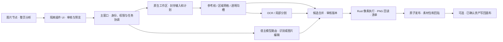

# 架构、数据契约与实施验收

2026-11-24 · 开发验收基线 · [产品入口与源码基线](00_需求与设计决策.md) · [研究矩阵](01_四类公开研究与选型.md) · [Image To Slice 专项](03_ImageToSlice专项对标与优化.md) · [模型协议与双密钥](04_模型协议与双密钥来源.md) · [切图与维护手册](05_切图实现与维护手册.md)

## 1. 运行边界与接入点

| 模块 | 生产入口和职责 |
| --- | --- |
| 独立用户插件 | 声明 API 2、宿主版本与专用必需能力，图片节点工具启动。按现有包规范校验 UI 摘要并声明权限，主入口走当前工具菜单。发布时核对 [逐帧拉片插件](https://github.com/luckcatlin2000/ai-canvas-video-frame-review-plugin) 的隔离 UI、显式安装和打包方式。 |
| 宿主会话 | 拟新增 `image.uiSlice` 能力，复用 `pluginUiSessionService`、原生 registry 和派生守卫。固定操作为 `open`、`startAnalysis`、`status`、`applyReview`、`preview`、`cancelRun`、`publish`，可选再生另有独立能力。新 API 数据为 schema 受控描述和句柄。QuickJS 只组织输入、结果和 UI 调用。 |
| 任务协调器 | 主窗口负责授权、模型配置、画布读写与 UI 限额。原生协调器持有输入、取消、暂存、提交和持久化收据。限制一个项目一个写任务，全局两个已分配像素工作区，推理设备每设备一个在途重会话。由协调器租约过期与硬退出回收时序管理。 |
| 模型路由 | 识别与再生各有用途绑定。宿主解析 AI Canvas 已有连接或插件专用连接，在可信执行边界取 Key。识别复用六项协议及活动的 Responses 预设，图片编辑按媒体适配器实测能力调度。插件 UI 获取脱敏目录、状态和经验证的候选。 [协议与宿主接口](04_模型协议与双密钥来源.md#2-协议矩阵与宿主接口) |
| 像素与推理 | Rust 按格式识别、方向、颜色、alpha 和像素上限预检。原生侧冻结工作计划，按单片处理及回读。CPU/DirectML 通过现有独立进程模式接入，补 worker 协议及生命期测试。桌面 PNG 路径全程本地可用，网络和推理是可切换任务阶段。 |
| 项目素材 | 首次发布使用宿主授权目录中的一个完整包。可选项目内落盘经原生项目媒体和索引流程，沿用项目/分集的素材所有权。随后用户选最多 25 项、一次 Store action 写回，并复核源节点和项目。大包始终可以一次导出，画布子集插入有独立提交记录。 |
| 预览层 | 按需返回低分辨率图、掩膜缩略及精确 1∶1 局部。结果列表分页，每页 24–40 行。宿主通过已授权预览句柄交付，缓存、对象 URL、位图和事件订阅随会话释放。复用现有主题、语言、焦点导航。 |

专用能力为新增设计。当前 `plugin-host.json` 仅有 `image.lineArt` 等相关能力，UI 通用资源读取预算为 16 MiB、96 次分段调用，UI 模型调用最多 4 次，VLM 通用限制 6 张图、单张 8 MiB、合计 24 MiB，仍须以实际模型限制取交集。整页流程在有授权的宿主任务内分组，避免逐片耗尽通用 effect 配额。离线首轮以规则和手工验收。接入模型时优先只发送获准的概览和少量必要 ROI。 [能力目录](../../../plugin-host.json) · [会话控制](../../../src/services/plugins/pluginUiSessionService.ts) · [图片额度](../../../src/services/ai/imageUtils.ts)

## 2. 批次契约

| 对象 | 必须字段与约束 |
| --- | --- |
| `SourceSnapshot` | `sourceId`、原始字节哈希、规范画布像素哈希、W/H、方向、色彩解释、规范化版本和受限资源引用。项目、来源节点和媒体签名属于内部任务上下文。解析后建立不可变工作副本，禁止复用旧画布中同名文件的句柄。 |
| `DeliverableSpec` | `specId`、模板版本、数量或下限、所需角色、文字策略、状态集合、父子与可复用要求。策划原话和可执行字段分别保存，自动翻译出的条目须可编辑并标注来源。每个条目都关联实例或缺项原因。 |
| `Proposal` | `proposalId`、`runId`、`baseReviewRevision`、原图整数框、候选角色、证据数组、几何/语义/像素分开的置信状态、来源与适用限制。证据引用来源/图块/OCR/素材签名。模型回复仅作为建议。 |
| `Asset` | 稳定 `assetId`、团队展示名、像素档、来源、用途、精确框、mask 版本、内容像素哈希与输出文件哈希、trim offset、格式与颜色。显示名重复由 UI 处理，文件名由宿主生成 ASCII 稳定 ID。 |
| `Instance` | `instanceId`、可空 `assetId`、原画布位置、`parentInstanceId`、`zIndex`、剪贴关系、原生或重建文字信息、状态角色、可选 pivot/九宫格。实例与素材分开。推断变换和自然尺寸要经回贴确认。剪贴、z-order 与业务分组使用不同字段。 |
| `ReviewRevision` | `reviewRevision`、父 revision、每项审核和选择状态、锁定字段、修改来源、`specId` 对应关系。状态含待审、确认、拒绝、缺源、超额待处理、不可复用和已完成。可以批量确认同一可证明类型。 |
| `PackManifest` / `Receipt` | `schema: ai-canvas-ui-slice/1`、`packId`、任务/审核/源摘要、素材、实例、交付要求及所有缺项、预览/回贴信息。收据含发布 ID、清单摘要、状态与仅供本机解析的目标凭证。对外清单展示项目配置允许的元数据，禁止写入真实路径、密钥、内部 grant 或远程请求内容。 |

素材包包含 `manifest.json`、`assets/<assetId>.png`、`review.json` 和可选的 `preview/recompose.png`。原图默认通过摘要关联，项目显式授权才随包。完整可交付与有缺项的批次分别显示。导出有缺项的包需要明确确认，成功回执同时报告确认数、素材数、失败和缺源数。视口外候选和超额项可继续分区处理，全部累计在同一逻辑任务，合并计划须再次计算整体预算。超上限时保留缺项记录并给出分包建议。

审核树支持每个实例的交付方式和各版本的证据。独立栅格、可编辑文字、受支持的形状和容器分组可共存。遮挡关系需引用底板和实际覆盖实例，修补需绑定源摘要、审核 revision 及可写掩膜摘要。原位框、可选裁边后尺寸及偏移独立表达。外部字段变更在冻结清单前确定兼容策略。 [结构与修补契约](03_ImageToSlice专项对标与优化.md#32-可编辑结构底板与交付状态)

### 像素档

| 档位 | 保证与用途 |
| --- | --- |
| `exact-source-rgba` | 对照已确认的原生透明源、可独立渲染的图层或授权原件，解码后指定区域 RGBA 逐字节一致。由来源和比对共同赋予 |
| `exact-composite-rect` | 平面快照中原尺寸矩形逐字节保真，保留截图合成的文字、底色与混色。可作为完整组合片 |
| `masked-source` | 以人工或固定硬边几何选区为基准。选区内原 RGBA，选区外透明黑，输出可逐像素验证。来源字段保存几何和审核 |
| `estimated-alpha` | 掩膜概率经几何或前景估计得到 alpha。需在棋盘格、黑、白和对比色底检查孔洞、抗锯齿、发光和残底 |
| `regenerated` | 补字下底板、补遮挡区或创建未展示状态，记录生成区、保护区、模型与版本和来源引用，独立候选，经用户验收 |
| `needs-source` | 证据不足或不可分离，保存目标和原因，无 PNG 或仅附供审阅的组合片引用 |

`exact-source-rgba` 和 `exact-composite-rect` 的比较目标在清单中显式指向规范像素。只要改边缘颜色、移除文字、估计透明或补像素就重新归档。配置颜色、隐藏 RGB 是否保留和适用范围随输入规范化版本固定。

### 几何、透明和归档兼容

- 以规范画布左上为 (0,0)，整数半开框 `[x0,x1) × [y0,y1)`。输入方向只处理一次。预览变换由容器缩放、留白和平移组成，DPR 仅用于显示缓冲。模型图块记录 ROI 原点、有效宽高、实际缩放 X/Y、letterbox 和坐标格式。先校验有限数与有效区域，再去留白、逆缩放、加偏移，框左上 floor、右下 ceil 后 clip。用有理数或固定点重放临界边界。纯留白框、零面积、溢出和超过允许范围返回可诊断错误。
- 例为原图 ROI 左上 (400,200)，尺寸 600 × 300，置入 640 × 640 输入，有效图像显示为 640 × 320，上下各留白 160。模型像素框 (64,192)–(320,352) 回投后为 (460,230)–(700,380)，原图尺寸为 240 × 150。
- 硬边多边形用像素中心、偶奇规则、整数/固定点扫描线。明确顶点和环上限，孔洞与岛状部件可分环。反转方向不改变偶奇规则。A8 掩膜按原图 ROI 储存或解码，直通 alpha 中 `outA = round(srcA × maskA / 255)`。精确档与硬边选区内保留源合约的隐藏颜色。硬边选区外和估计掩膜的全透明输出像素写透明黑。软边去色对独立、经确认的估计前景进行。
- 原生输出为原尺寸 8 位 sRGB PNG、straight alpha。支持带 sRGB 标记的 PNG，与明确确认后按 sRGB 解释的无配置图。ICC 已知且有验证转换器时先转换并记录算法、输入/输出质量，未知 ICC、HDR、未支持的 PNG 高位深、空图或损坏返回可解释失败。JPEG 相对于固定 decoder 和方向策略验证。哈希应区分源文件、规范像素和编码文件。
- 在扁平图中，线性光空间的一个合成观测可表示为 `C = αF + (1−α)B`。边缘前景、背景与透明度同时未知，需原稿、其他背景上的证据或估计。业务上可见的矩形、可独立部件与需要补全的缺项均在清单表达。
- PS-Tidy `slice-v1` 用只读适配导入 `source.sha256`、role、框、选区、审核 revision 和文件校验。PNG 与源摘要必须核对。`composite_rectangle` 对应合成矩形档，`polygon_mask` 对应硬边蒙版档。`source_rectangle` 的来源需要核对，按文件内容与明确的原生素材证据判定。PSD 本期以证据接入小样推进，后续通过独立适配器写透明层、文字和复合组。九宫格、pivot、PPU、trim 与轴转换来自目标 Unity 项目的确定规则，按真实工程重开验收。旧清单和未知 schema 分别可读兼容与拒绝，禁止静默猜字段。 [PS-Tidy 像素代码](<../../../../../PSD2UI/PS-Tidy/native/crates/core/src/rgba.rs>) · [PNG 规范](https://www.w3.org/TR/png-3/) · [Unity 9-slicing](https://docs.unity3d.com/en-us/engine/6000.0/manual/unity2d/sprite/9-slice/9-slicing)

## 3. 整页识别、语义理解和再生

1. 先把策划说明转成带证据的 `DeliverableSpec`。初始模板给角色词汇、固定区域、期望状态、复用策略和文字区分。自然语言识别得到的「未展示禁用态」进入缺项列表。导出准备度由实际条目覆盖计算。
2. 桌面本地先用参考线、区域网格、透明沟槽与连通域生成几何候选，再应用低倍率概览、重复模板和受权素材指纹。分隔线与语义交付分别核对。只对规格和几何均已覆盖的对象跳过相应模型环节。保留穿线、嵌套、小目标和超额 ROI，已有透明原件走严格对齐比对。素材检索先限当前项目有权资源和指定类型。 [规则和坐标](03_ImageToSlice专项对标与优化.md#31-前移确定性切片)
3. OCR 按概览和原图 ROI 推进。按文字框、位置、读取顺序及转写保存，采用单字符与词级置信，数字、单位与标点原样留存。原生源文字作为可追溯证据另计。发现固定文案和动态变量模板冲突时待审。
4. 按预算执行分块检测。建议起步 1024px 图块、160px 重叠，边缘 tile 锚到图边，保留全图缩略和坐标变换。每块先预分配稳定 ID。优先小图标、文字密集和构图难区。交界用同角色、同来源和几何一致性做确定性融合。嵌套的底板、图标、徽标、文本以及相同素材不同实例均保留。按页坐标、部件类型和证据优先级排序，避免异步顺序影响结果。
5. 局部目标用框、正负点和父区约束给提示分割。对孔洞/阴影用多个候选掩膜，按角色和背景对照审核。持续记录哪类候选来自规则、OCR、分割、检索或语义。模型得分在独立集按角色校准，低样本的置信标为未知。
6. VLM 可选增强角色、读序、父子、缺项和状态。只发送经确认的概览及必要 ROI，在白名单 schema 中选择对象 ID、角色和证据。检测阶段生成的坐标由宿主执行映射，VLM 提议新框需独立验证。校验上限、空字段、截断、UUID/ID 归属、引用环、重叠冲突。低置信、跨模型意见冲突和外发失败均进入待审。
7. 按 `specId` 核对覆盖。手工框选、套索、数值微调、局部精修、拆组都作用在同一审核树。并行发现的结果按稳定顺序合并，一次写入审核 revision。局部重跑保留已人工修改、已锁定和已拒绝项，对冲突只建新建议。成功拆分由单次审核编辑替换组关系，可撤销。确认「同素材」前先核对像素、尺寸、颜色、用途和导入设置。
8. 对已圈选缺项，再生分别使用去字补底、补遮挡或衍生状态三种目标。每项冻结源像素、角色、ROI、允许写入的掩膜、保护区、模型/工作流版本、可用 seed 和预算。可用通道须预检图像编辑、输入传输方式、mask 支持、尺寸和费用，区域能力缺失时提供明确失败或改用本地备选，经确认后才发。优先聚合预算与任务状态，逐项对照校验输出尺寸及类型。模型返回经 Rust 在原坐标合成，掩膜零值或保护区 RGBA 必须与输入逐字节一致，羽化限制在许可区。用户复核后切换交付引用，原证据、生成结果和版本均保留。

能力切换边界为角色解释、OCR、检测、分割、再生适配器。单个适配器不可写审核或发布状态。已有图片模型支持的细项按宿主实际 adapter 和模型配置核对。禁止默认通过额外图床、回退厂商、未知端点或更高成本模型重试。 [模型调用](../../../src/services/plugins/pluginRuntime.ts) · [图片生成](../../../src/services/ai/generateImage.ts) · [媒体注册](../../../src/services/ai/mediaProviderRegistry.ts)

## 4. 生命周期、恢复与安全

| 工作流 | 守卫及失败效果 |
| --- | --- |
| 初建与冻结 | 主窗口先验证已激活插件双摘要、当前项目、源节点和宿主授权。将可读对象固定到工作区，核对指纹和权限。来源失效则终止并带错误码。 |
| 识别和精修 | 子操作有 `runId`、`requestId`、`generation` 与基础审核 revision。工作区按项目、插件版本和源摘要绑定。界面关闭、切项目、换源图、停用/更新/卸载时撤销会话与相关执行租约。旧回包按 token 拒收。 |
| 审核与恢复 | 批次阶段允许在可审阅态多次生成单调递增的审核 revision。每次重跑用独立 attempt，有自己的终态。持久化范围包括版本化草稿、输入摘要、原生工作区 ID 和脱敏的连接及请求收据。恢复前验证项目、源、文件和安装版本，重新发放本地租约。继续查询远端作业时，另校验原连接和查询权限。来源变更需要显式重开快照或审阅既有只读包，已中断分析无隐式自动重投。 |
| 发布准备 | 锁定源、审核 revision、目标身份与导出配置。原生预检路径、预算、权限和当前租约，目标卷上建排他的应用私有暂存目录。串行出片，每张回读独立比对期望像素/掩膜、尺寸、编码哈希及像素哈希。写清单与审计摘要，落盘并生成可恢复提交意图。 |
| 提交 | 原生按 `publishId`/目标串行。再次复验审核绑定、目标目录身份、临时文件与报告；同一个协调器仲裁撤销与提交。发布路径使用同卷 no-replace 目录提交，禁止替换已有目标。若目标无已验证的原子发布语义，保留管理区结果并报目标不可用。 |
| 收据、未知状态 | 目录发布是素材包可见生效点。随后记录收据。提交动作之后用户取消，返回既有收据或先对账。停电或进程丢失响应时依据提交意图、清单和所有文件摘要修复收据；冲突或校验失败为明确待处理。重试同意图复用有效收据。目标校验失败时禁止冒充成功及覆盖，保留原暂存证据。 |
| 回到画布 | 已发布包导出完成后才允许用户发起独立写回。读取素材和结果摘要，临时保存候选，最终检查源内容、项目、节点和画布 revision，经原有单批 Store Action。失败收回该写回独占创建的资源和临时文件，记录补偿，已导出的包仍可用。 |
| 取消和清理 | 提交前取消使对应 attempt 进入取消处理，禁止新 work，停止 worker 并等待退出和句柄关闭，再释放内存、临时物料和锁。只清理有所有权凭证且未提交的暂存。崩溃后扫描有界工作区，孤儿回收经年龄、锁和收据验证。模型若已受理且无远端取消或查询能力，记录提交未知及可能开销，允许用户对账。 |

一次发布沿 `prepare → verified → commit-pending → committed` 推进。提交仲裁前允许终态 `cancelled` 或 `failed`。已进入提交的操作以原生收据、回读或可人工核对的 `commit-unknown` 结束。长任务进度只传计数、阶段和错误码，轮询或事件同样校验身份并限频。一致性测试要覆盖取消先到、在核验与提交之间到、提交后到、同一目标并发、项目删除和崩溃时重开。主窗口关闭及 worker 退出后，状态方向仍由原生提交事实决定。

发布幂等键含随机任务 ID、审核 revision、源和配置摘要及稳定目标身份。编码前由独占创建保护，重试同一意图始终检查已存在最终目录的可信清单和文件。能匹配则回填收据，无法证明同一批次则报冲突。暂存与最终目录用可信句柄或平台等效方式验证真实路径和身份，Windows 本地卷先验收 no-replace、目录身份、重解析点及杀进程故障。文件和目录同步能力按平台证据标注，断电恢复以重开实测为准。 [归档目录发布](../../../src-tauri/src/files/project_archive.rs) · [原生媒体发布](../../../src-tauri/src/files/native_project_media.rs)

- 安全边界绑定窗口、会话、插件 ID、双摘要、工具、调用 ID、项目、源签名和资源租约。命令在 Rust 复验，主窗口按 action 做画布二次守卫。插件或模型不能传绝对路径、命令、可执行脚本、任意 URL、网络鉴权或请求头。桌面仅通过已选目录和资源授权访问真实路径。
- 输入字节与实际媒体签名校验，宽高和 buffer 长度先做 checked arithmetic。拒绝 SVG/HTML、伪装后缀、动画和未支持的色深。导入包限制总压缩/展开、项数、路径长度，拒绝越界、重复条目、链接和重解析点。命名用宿主 ID，业务名纯文本显示。项目和外部目录遇到竞态则拒绝。第三方依赖和模型产物需固定哈希、来源、训练/分发约束和更新回退路径。
- 云调用优先最小像素范围，授权界面显示厂商、位置、尺寸、用途、最多调用数及费用可知程度。默认本地和关云。图片内文字和模型响应作为数据，插件仅解析固定 schema。凭据留在宿主 secret store，日志保留阶段、耗时、计数、错误码、版本和脱敏关联 ID。
- 错误适配至少覆盖 `UnsupportedFormat`、`UnsupportedColor`、`BudgetExceeded`、`StaleContext`、`InvalidModelResult`、`SourceChanged`、`DestinationConflict`、`Cancelled`、`CommitUnknown` 和 `ProviderSubmissionUnknown`。UI 给出受影响范围、可恢复的审核位置及重试入口。

## 5. 性能与零堆分配验收

以参考工作站 Windows 11、8 物理核心、32 GiB RAM、NVMe、CPU 路径和 3840 × 2160 图为第一轮环境。以下均为拟定目标，需要从实际设备和项目样本校准。每组至少 30 次热运行，冷启动单列，输出 p50/p95/max、峰值 RSS、显存、外发开销、模型耗时及人工耗时。

| 预算 | 建议值 |
| --- | --- |
| 接入与工作区 | 压缩输入 ≤ 64 MiB，边长 ≤ 8192，规范化像素 ≤ 32,000,000，单片 ≤ 8,000,000 输出像素。整页每任务先支持 256 个候选、128 个素材和 64,000,000 总输出像素，最多 64 个检测 tile。首期原生输出包 ≤ 512 MiB，单任务临时总量含目标暂存 ≤ 2 GiB。超限在开始实际写入前列明影响。 |
| 热路径 0GC | 已预热 Rust Release，输入、输出、行扫描 scratch 和掩膜从调用方借用。规则投影与沟槽扫描、矩形拷贝、硬边与 A8 路径、边界统计和逐像素回读比对循环均为 **0 次堆分配/重分配、0 分配字节**，用计数分配器逐项证明。覆盖空或满 mask、奇数 stride、混排网格、跨 tile、透明像素和取消检查。编解码、任务注册、模型会话、UI 与上传分别测量堆、RSS 或 GC。 |
| 缓冲与 IPC | 最多一份常驻规范化原图、一项出片缓冲及有界验证 scratch。32M 原图约 122 MiB，单片 8M 约 30.6 MiB。流式写出和回读，禁止把所有 PNG 或 RGBA 同时保留。像素活动进程 RSS p95 ≤ 512 MiB，模型进程另报，Windows 原生限制专项。IPC 传 metadata、受限缩略图与工作区句柄，预览缓存按字节 LRU。 |
| 可用性 | 4K 首张可交互预览热 p95 ≤ 400ms，调框目标交互帧 p95 ≤ 20ms。规则与本地 OCR 完成 p95 ≤ 15s，4K 30 项且累计输出 ≤ 12M 像素的已确认 PNG 整包 p95 ≤ 8s。记录明显扩容时耗时曲线。云超时和用户等待不混入本地指标，各适配器另定义耗时上限和状态提示。 |
| 释放与故障 | 本地计算取消接收 p95 ≤ 150ms，worker 在有界宽限后退出，目标 p95 ≤ 2s，系统 I/O 测尾延迟。循环 100 次打开、取消和重开后，活动 worker 与租约归零，工作区无未归属文件，稳定内存增长目标 ≤ 5%，独立记录浏览器 GC 时机。 |

启动时一次性分配可复用 scratch。扫描线避免每行动态容器，按扫描块检查取消。PNG 编码、回读、缩略图生命周期单独计账。常态先用串行出片，有证据证明瓶颈后比较最多两个编码槽，保持相同峰值预算与输出稳定排序。SIMD 仅在建立标量参考并量化长尾收益后引入。按 PNG 解码后的像素比较，同时校验文件哈希。组织方式参考 PS-Tidy 的 Release 零分配测试，AI Canvas 需要独立实现和复验。 [PS-Tidy 测试参考](<../../../../../PSD2UI/PS-Tidy/native/crates/core/tests/zero_alloc.rs>)

## 6. 阶段、门槛和迭代顺序

| 阶段 | 主要交付 | 放行证据与回退 |
| --- | --- | --- |
| P0 · 协议和样本 | 读取当前 Git 变更与宿主版本。固定格式、权限边界、半开坐标、色彩和双密钥绑定。准备六种识别选项的协议夹具、首充复验、透明/遮挡合成图、未知 ICC 和 UI 标注基线。给原生目录发布和硬边裁切做独立小样 | 复现原样本，两张 PNG 共 551,180 字节一致；验证种子样本可导入，取得 Windows no-replace 和失败恢复证据；该阶段先保持工具入口隐藏 |
| P1 · 可用离线插件 | API 2 原生任务、手工框选和套索、参考线、区域网格和严格透明沟槽建议。用同一审核与出包链处理 36+ 部件，提供回贴、全量包和收据 | 混排网格、触线、逐像素对照、0 分配、取消并发与旧入口回归通过。可关闭规则候选或回退插件版本 |
| P2 · AI 整页识别 | 上线 OCR、分块、置信校准、原件提议和局部掩膜。以宿主共享或插件专用凭据调用视觉模型补角色、层级和缺项。覆盖导航、首充、奖励与排行并输出可编辑结构建议 | 双来源 × 六项协议完成带图夹具和 Windows 试跑，覆盖 Responses 内置与插件预设、跟随连接默认值和高级 JSON。按模板盲测达到识别门槛，并验证锁定项、小目标、候选超额和离线出片 |
| P3 · 受控再生 | 去字补底、遮挡补全和新状态候选，使用已预检的本地或云模型。审核覆盖关系和保护区，保留基准、已合成候选、来源与重试收据 | 每个上线通路通过实机图片编辑、回投与本地可写掩膜验证，掩膜外 100% RGBA 一致。声明支持供应商蒙版的通路另验云端入参。验证视觉采纳、授权、费用、取消和提交未知处理。关闭再生后保留缺项报告 |
| P4 · 项目互操作 | 已验证素材显式入库、选中子集写回，分层 PSD/文字与 Unity 导入分阶段。跨平台验证桌面能力。Web 先演示和轻编辑 | Photoshop 保存重开、Unity 导入运行复验、画布撤销及资源索引生命周期；专项未通过的适配器用显式能力开关隔离 |

### 真值集和建议门槛

建立至少 60 页授权样本，覆盖四套模板、多种美术风格、分辨率和中文/英文及混合文本。按项目或皮肤分组切分 20 页开发、40 页封存验收，避免同素材跨组泄漏。每页标交付清单、实例框、可见与全对象轮廓、alpha 真值、文字、层级、素材引用及不可恢复项。定义小目标为短边 ≤ 32px，建议封存至少 1,000 个应交付实例，每个罕见类计有效样本并给置信区间。两人标注并处理争议。模型效果差异按页给置信区间和分组样本数，稀疏组保留人工默认。

| 假定放行门槛 | 统计口径 |
| --- | --- |
| 精确档和安全合同 100% | 解码后 RGBA、坐标与宽高、清单/文件摘要、保护区、撤销和发布幂等全部通过。任一错误阻止对应能力放行 |
| 整页候选召回 ≥ 95%，精确率 ≥ 90%，小目标召回 ≥ 88% | 按角色和位置的一对一匹配，实例 IoU ≥ 0.5，去重与召回分开。对很小目标另报中心绝对误差及像素结果。按页记录完全覆盖率和遗漏角色 |
| 语义 macro-F1 ≥ 0.85，常规可读文本 CER ≤ 5% | 角色按确认类别计算，父子与层级约束另报 F1。冒号、斜线和数字前缀按完全匹配逐例验收。艺术字或低清文本分组 |
| 硬边 mask 中位 IoU ≥ 0.90，边界 F1@2px ≥ 0.85 | 只在可取独立前景真值的项计算。软边另报 alpha MAE（建议 ≤ 0.05）与黑白/对比色底回贴，遮挡补全单列 |
| 可独立复用率 ≥ 90%，人工审核中位时间下降 ≥ 30% | 分母为应独立交付的部件，移动图标、关掉动态文字、底板重着色后仍正确才计入。与同一组美术人工基线对照，统计等待、返工和失败。生成候选另报采纳率 |
| 已确认需求条目 100% 有状态 | 分母为经确认的规格项。逐项列完成、估计、缺源/待补、超额和拒绝。对规格遗漏另测模型自行发现的召回 |

阈值属于放行目标。真实结果未达标时保留人工或局部精修，并记录受影响模板和角色。严谨性通过质量门槛、故障注入和灰度观察证明，开放范围由实测决定。

### 兼容和回归清单

- 覆盖 PNG 的 sRGB/已知 ICC/未知 ICC、透明或全不透明、隐藏 RGB、奇数宽、JPEG EXIF、输入大尺寸、空遮罩、孔洞、瓦片接缝、128 个素材与 36+ 交付。规范化版或 encoder 变化时重跑两套哈希，文件不同的合法输出仍须像素一致。
- 模型专项用导航五图标、奖励卡去字与计时器 `28:58`、`02:36:18`、`50/100`、`x100`，比较开灯/熄灭状态以及桌椅遮挡。检查一素材多实例、前后顺序、混合模式和未展示态。模型返回部分、限额、异常结构、断网、取消或未知提交须有明确状态。
- 桌面用 Windows WebView2 实际打包版本、普通与高 DPI、多屏、中文路径和无写权限目录，验完整入口与清理。macOS/Linux 分别记录 OS、WebView、CPU 和文件系统语义，验证通过再开放对应能力。Web 可演示浏览与审核，交付能力按宿主声明。
- 同目标并发、磁盘满、路径被替换、干扰同名发布、切换项目和关闭窗口。分别在记录意图前、提交前、提交后收据前和写回前强制终止，重开后核对完整包、错误收据和清理。擦除和整理局限在本任务拥有的已验证路径。
- 回归普通裁剪、序列帧分帧与图集、逐帧拉片、API 1/2 插件安装切换、对话与文本节点、图片模型、项目素材删除/恢复、撤销与旧数据库读取、发版升级和关闭清理。旧用户包保持可读，未知版本有明确错误。协议改动追加 Key 轮换、连接／预设撤销、脱敏与迟到回包回归。 [协议放行矩阵](04_模型协议与双密钥来源.md#4-请求校验与协议放行)
- 实施后在 `D:/AI Canvas Tauri/source` 按仓库当前规则运行经授权的 `npm run check` 及对应原生测试或构建，在 `D:/AI Canvas Tauri/source/src-tauri` 运行经授权的 `cargo check`、`cargo test` 和 Release 分配统计专项。以 [仓库开发指南](../../../doc/开发指南.md) 和 [仓库规则](../../../AGENTS.md) 为执行依据。

本阶段交付设计与研究，AI Canvas 的测试、构建、基准和桌面实机验收待后续验证。
