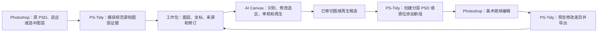

# AI Canvas 与 Photoshop 双向协作实施补充

2026-11-25 · 设计与兼容评审 · 核对 PS-Tidy 0.7.5（`e4aef4f`）、AI Canvas 工作树（基提交 `69b69160`）和外置切图插件 0.3.2。

本篇定义 Photoshop 文档的读取、原位写入和直接编辑后的回传。切图工作稿、坐标、图层树和跨端修订沿用 [07 切图工作包互通](07_PS-Tidy与AI-Canvas切图工作包互通.md)。交互和模型设计沿用 [06 AI Canvas 工作台](06_可编辑切图工作台与PSD实施报告.md)及 [PSD2UI 09 PS-Tidy 工作台](<../../../../../PSD2UI/analysis/效果图AI切图_20261123/09_PS-Tidy层级切图工作台与Photoshop交付实施报告.md>)。前序实机证据来自[调研 AI 精确切图方案](codex://threads/01a20761-9060-7e73-9fa8-e8641d3ef82c)。

## 1. 双向协作流程

| 用户入口 | 操作与结果 |
| --- | --- |
| Photoshop → AI Canvas | 在 PS-Tidy 选择「当前文档」「当前像素选区」或「选中的图层」，预览捕获范围，导出工作包。AI Canvas 导入后能原位查看并编辑，按选区范围执行识别，或把对应素材作为图生图输入。 |
| AI Canvas → Photoshop | 从选中一片、选中组或整稿提交已审版本。PS-Tidy 识别目标与坐标后创建同尺寸分层 PSD，或在用户明确选中的当前 PSD 中按原位添加新组。已有 AI Canvas「在 Photoshop 中打开」用于打开素材或经验证的导出文件。 |
| Photoshop 改完 → AI Canvas | 在 PS-Tidy 选择由该工作稿导入的组或明确关联的图层，扫描相对导入时的命名、位置、层序、显隐和像素变化。用户确认后输出回传工作包，AI Canvas 应用到相应修订或保存为分支。可把单片作为新候选送画布或再次生成。 |
| 单片补图 → Photoshop | 在 AI Canvas 检查本片、上下文和保护区，编辑提示词并选生图模型。审阅选中的候选后回传。PS 默认把候选作为独立层加入，让美术切换版本、修改蒙版或继续绘制。 |

首轮用显式工作包交换，支持两端独立运行和离线编辑。PS-Tidy 提供 Photoshop 文档读写，AI Canvas 复用已配置的模型、图片生成和画布节点。若实测文件选择成为主要操作成本，再让两端通过受控文件交接和作业收据简化打开步骤。已有「在 Photoshop 中打开」用于定位并打开文件，PSD 修改由 PS-Tidy 按文档与图层身份回采。 [现有 Photoshop 入口](../../../src/services/fs/externalEditors.ts#L69) · [AI Canvas 模型协议与双密钥](04_模型协议与双密钥来源.md)

## 2. Photoshop 宿主入口与兼容策略

| 环境 | 首轮处理 | 启用条件 |
| --- | --- | --- |
| Windows x64 + PS-Tidy CEP | 复用 ExtendScript 固定命令、文档副本、Rust runner 与单次历史提交。先验收快照、硬边取样、PNG 原位入层，再单独验证原生像素选区和图层回采 | 现有 CEP 清单声明 PHXS 24.0–27.9、CSXS 11。历史实机证据覆盖 Photoshop 24.0.0 的捕获用例。新版各能力以具体版本、CEP 加载和单项实测放行。 [CEP 清单](<../../../../../PSD2UI/PS-Tidy/CSXS/manifest.xml>) · [PS-Tidy 运行时](<../../../../../PSD2UI/PS-Tidy/README.md>) · [历史实机](<../../../../../PSD2UI/analysis/效果图AI切图_20261123/08_首版实施与放行判定.md>) |
| Photoshop UXP | 作为下一阶段宿主适配。用 Imaging API 读合成/指定层像素、选区和蒙版，用 `executeAsModal` 管文档修改，配合历史提交/回滚和临时文档回收 | 逐能力查实际 API、Photoshop/UXP 版本和平台状态。文件交换走用户文件选择或受控路径授权。现有 Windows x64 runner 的能力另行映射与验证。 [Adobe Imaging API](https://developer.adobe.com/photoshop/uxp/2022/ps_reference/media/imaging/) · [Adobe 模态执行](https://developer.adobe.com/photoshop/uxp/2022/ps_reference/media/executeasmodal/) · [Adobe UXP Manifest 5](https://developer.adobe.com/photoshop/uxp/2022/guides/uxp_guide/uxp-misc/manifest-v5/) |
| 有 Photoshop，PS-Tidy 能力未启用 | 通过 AI Canvas 分层 PSD 交付后手动打开。回传用受支持的图层 PNG 和定位清单，或装载可用适配器后从工作包继续 | 依赖独立 PSD writer 的真实 Photoshop 重开验收。没有层表和稳定关联时，回传作为待匹配素材。 |
| 无 Photoshop，或未覆盖的操作系统 | 在 AI Canvas 继续工作稿编辑、PNG/ZIP、工作包及画布回传，分层 PSD 按独立 writer 能力提供 | Photoshop 当前文档、选区及层操作由宿主探测决定。macOS 的整套 PS-Tidy 运行时和 UXP 均需独立验证。 |

能力探测返回宿主版本与当前可执行动作。读画布、读像素选区、读原生栅格层、保留可编辑蒙版、新建 PSD、写当前组、回采映射组分别登记。Photoshop 版本、文档颜色模式、位深和图层类型共同影响动作。可用入口应给出从当前状态继续的路径，如切换到合成快照或新建 RGB 8-bit 副本。 [Adobe CEP 资源及宿主支持表入口](https://github.com/Adobe-CEP/CEP-Resources) · [Adobe UXP Document API](https://developer.adobe.com/photoshop/uxp/2022/ps_reference/classes/document/)

## 3. 从 Photoshop 取图和取证

| 来源 | 获取方法 | 精确切图的处理 |
| --- | --- | --- |
| 当前文档可见合成 | 复用 `sliceSnapshot` 的隔离副本，将完整画布规范化到 RGB8 sRGB，记录合成范围、尺寸、转换路径及摘要，捕获后恢复活动文档 | 提供 AI 上下文和原位基准。截到的隐藏部分留缺源。可见合成上做的矩形和多环沿用现有像素质量档。 [现有快照](<../../../../../PSD2UI/PS-Tidy/host/main.jsx#L313>) |
| 当前像素选区 | PS 中矩形、套索或载入的选区可作为取样范围和 ROI。冻结与画布对齐的边界和选区掩膜。无选区时使用另选的明确范围。灰度或羽化选区沿用 07 的扩展能力门禁，支持前可带原遮罩作复核附件，或由用户确认硬边版本 | 保留选区软边及洞的证据。只得到选择 bounds 时显示矩形待审，不能据此认定选区形状。Adobe UXP 的 `getSelection` 返回像素选区，可作为适配对照。 [Adobe Imaging API](https://developer.adobe.com/photoshop/uxp/2022/ps_reference/media/imaging/) |
| 当前选中图层或组 | 先读图层 ID、父级、顺序、显隐、类型和依赖。对可独立交付的栅格层，在隔离副本或只读像素 API 中获取图层内容和实际边界 `sourceBounds`。有蒙版时分别记录未应用及已渲染像素能力 | 原生可用层优先于 AI 猜测。剪贴、混合、图层效果和调整层保留依赖说明。用户可选原生 PSD 保留，或生成带来源的栅格候选。文字层和智能对象的可编辑性保存在源 PSD 或由 Photoshop 在整文档副本中维持。 [现有层表读取](<../../../../../PSD2UI/PS-Tidy/host/main.jsx#L33>) · [Adobe Imaging API](https://developer.adobe.com/photoshop/uxp/2022/ps_reference/media/imaging/) |

每次捕获绑定文档会话、画布尺寸、像素方向、模式、位深、色彩配置、所选层 ID 和 ROI。捕获前后核对文档及相关状态。先前 `historySignature` 将历史数量和名称拼接，可辅助检查面板操作。跨应用、重启或出包的身份以规范图摘要、文档关联和所用图层/选区证据为准。源文档发生位移、裁边或画布改变时建立新源版本，并显式记录坐标映射。AI 的屏幕图发送范围和确认状态沿用工作台方案。 [现有宿主校验](<../../../../../PSD2UI/PS-Tidy/host/main.jsx#L83>) · [工作包规范图与坐标](07_PS-Tidy与AI-Canvas切图工作包互通.md#4-v1-工作包契约)

UXP 适配须以 API 实际返回的边界为准。用于精确出片时验证原生尺度、通道和色彩档，保留透明度。Adobe Imaging API 的 `applyAlpha: true` 会在白底合成并去掉 alpha。按请求释放 `PhotoshopImageData`，给面板传小图及句柄。现有 CEP 快照在副本中转换到 sRGB 并通过 Save for Web 输出 PNG。待共享规范收口时，对于编码色标、来源 ICC 和 Photoshop 内部转换分别记录，避免在另一端误判或重复颜色转换。 [Adobe Imaging API](https://developer.adobe.com/photoshop/uxp/2022/ps_reference/media/imaging/) · [CEP 快照实现](<../../../../../PSD2UI/PS-Tidy/host/main.jsx#L313>)

## 4. AI Canvas 结果原位进 Photoshop

1. **冻结写入计划。** 固定 `operationId`、工作稿 ID、修订和摘要，包含选中对象、PNG 及摘要、素材完整边界、alpha 内容边界、工作包坐标、分组顺序、可见分支、目标文档信息和不支持项。生成候选仅在用户采用此版后进入已审计划。
2. **选目标并预检。** 默认可创建同尺寸 sRGB RGB8 分层 PSD。选择「添加到当前 PSD」时，通过宿主确认当前文档、尺寸、颜色、画布原点和预期历史上下文。与源尺寸不同或做过画布裁剪时，应先展示平移/对齐预览及受影响范围。首版可将不同尺寸的目标导向新副本。路径和临时句柄由宿主授予。
3. **提交并读回。** 在单次 Photoshop 历史提交中创建独立的新组。按工作稿从底至顶的顺序写入，并复核实际组内顺序。像素的导入位移按「未裁边放置＋透明裁边偏移＋PNG 内实际 alpha 原点」校准。读取宿主 bounds 时区分可见内容、图层蒙版和带效果范围。组内隐藏参考、组件/子层互斥与透明空件按计划处理。现有 `replaceArtwork` 具有跨文档复制和像素平移参考，新命令只将候选添加到自己的组。 [现有复制和平移](<../../../../../PSD2UI/PS-Tidy/host/main.jsx#L135>) · [现有 CEP 历史封装](<../../../../../PSD2UI/PS-Tidy/host/main.jsx#L734>)
4. **回滚、接管与核对。** CEP 复用已有历史封装并验证异常回退、活动文档和执行前选择恢复。UXP 在模态作用域内验证后显式提交历史，异常走 `resumeHistory(suspensionID, false)` 或经验证的模态回滚，并回收暂存文档。新建 PSD 路线暂存后重开复核，再独占发布。已经提交到当前文档的操作以回执追踪，另行显示 PSD 的保存状态。 [Adobe 模态执行](https://developer.adobe.com/photoshop/uxp/2022/ps_reference/media/executeasmodal/)

回执至少包含操作 ID、工作稿和修订、文档关联、导入根组、工作稿对象 ID 到 Photoshop 层 ID 的映射、初始内容摘要、位置、顺序及核对结果。一个导入动作前后分别记录目标。等待 Photoshop 响应超时则进入「结果待核对」，沿已有桥接排空状态管理该命令。根据映射、组标识及文档状态确认已提交、可重试或需人工核对。外部回执写失败须允许补建记录，避免把实际已入层的操作再次执行。 [现有 CEP 未决处理](<../../../../../PSD2UI/PS-Tidy/lib/host-bridge.js#L75>)

## 5. 美术在 PS 中直接修改后的回传

PS-Tidy 从导入回执明确定位根组，并用原修订验证身份。当前会话内使用文档 ID 与层 ID。重启、另存、复制文档后，先核对用户选定文件/文档与对应回执，并校验导入根组或经验证的外置映射。持久文档元数据作为后续验证项。发现重复导入、映射丢失或层 ID 变化时，展示候选匹配和原始/当前预览，让用户确认具体层。名称可辅助匹配。保存时给回传版独立身份和基线修订。

| Photoshop 里的改动 | 回传记录 | AI Canvas 处理 |
| --- | --- | --- |
| 重命名、原位平移、显隐、组内重排 | 记录对应对象和改前/改后属性。纯平移需同时匹配相对于图层内容的像素摘要、尺寸及蒙版语义 | 保留素材与取样框，更新显示属性或 `placement`。 |
| 画笔、擦除、改色、已烘焙的变形 | 输出有位置和摘要的新素材。保留导入版本、源取样和处理证据 | 建立可对比的 PSD 派生版本，重审像素。 |
| 改可编辑蒙版或效果 | 在支持独立掩膜时附内容与位置。若只能渲染，保留烘焙像素、源 PSD 关联和影响说明 | 可放置并复核新像素。原有工作稿轮廓和旧材质仍能回读。 |
| 删除、新增、复制或跨组移动 | 报告明确的删除建议、待匹配新层及结构变更。对源组外的未授权层提示手动关联 | 新层分配新 ID，删除经确认。暂时无法验证的映射进入待审。 |
| 两边改了同一对象或图层重新取样 | 双方基线不同或同一字段存在分歧时列出基线、AI Canvas 版、Photoshop 版 | 首轮保存双方分支并显式选用版本。依据已验证祖先且目标稿无额外编辑时可快进。 |

回传更新的是工作稿修订。用户可随时保存原 PSD 和新版 PSD。场景需要完整保留文字、智能对象、调整层、剪贴链、混合模式时，与工作包同时交付原生 PSD 副本。工作包对这些对象保留可审核的渲染结果与来源依赖。评审视图同时显示 PS 保存状态和工作稿应用状态。

## 6. 隔离、恢复及验收顺序

- 两端以独立项目副本和 07 的工作包修订合同协作。现有 PNG/ZIP 的坐标继续可迁移。模型输出只能提交结构化建议。跨端交换仅使用经验证的工作包、素材和白名单宿主操作，凭据留在各自宿主。文件交换先验摘要、类型、预算和权限，再进入文档提交。 [工作包版本与生命周期](07_PS-Tidy与AI-Canvas切图工作包互通.md#5-工程接入版本和生命周期)
- 预检、PNG 物化、解码与回读在事务外完成大部分工作。进入 Photoshop 写入阶段后逐层复制、合适粒度核对并及时关临时文档。对照 128 项压力样本分别记录 native 峰值内存、PSD 临时空间、CEP/UXP 文档占用时间和中断恢复。原生扫描线 0GC 约束按既有用例测算。Photoshop、编码、模型及桥接单独记录时延和内存。
- 未验证直入时可在两个面板间交换工作包、PNG 和已验证的分层 PSD。失败回采保留原工作稿及历史回执。PS 写入可回到导入前的历史，已落盘的另存 PSD 使用独立收据定位。

| 阶段 | 用例及通过条件 |
| --- | --- |
| P0 · 先验证一次可逆的原位入层 | 用现有 750×1334 首充两张裁片。60 钻卡为 `[59,357,373,574)`，300 钻卡为 `[374,357,695,574)`。在 Photoshop 24.0.0 创建新 PSD，核对画布、中文组名、层位置、遮罩与顺序。再次在目标副本添加新组，PSD 保存后重开复核，并用一次撤销测试当前文档入层。另测透明孔洞、缩进偏移和半透明合成小样。 |
| P1 · 跑完整双向链路 | PS-Tidy 选两张卡中一张 ROI → AI Canvas 导入 → 修正轮廓和语义 → PS 原位入层 → 移动一层并修改一处像素 → 回采该组 → AI Canvas 查看差异并应用。确认取样与放置独立、变更归到原对象、未改像素与原位一致。然后交换方向再跑一次。 |
| P2 · 真实选区、图层与故障 | 用带羽化选区、隐藏图层、多个文档、中文路径、嵌入 ICC、16-bit 与剪贴组的夹具单独核对支持/降级行为。模拟切换目标、仅另存 PSD、层映射丢失、PS 撤销、重复点击、回执异常和重启。旧项目与其它文档保持可用，结果可确定或落入明确的待核对状态。 |
| P3 · 再生、规模与扩展宿主 | 从工作稿选择缺源处并编辑提示词再生，验证保护区和回传版本。用 128 层及大尺寸夹具评估耗时和内存。依实际部署目标选额外 CEP 版本与 UXP 平台，实测本表同项后公布兼容矩阵。 |

本轮对照双方会话、文档和源码，重新核对历史两张 PNG 的尺寸与 SHA-256，均与原清单一致。历史 PS-Tidy 记录中的 RGBA 验证用于基线。新增协作合同、真实 PSD 新建/入层、PS 内编辑回采、各宿主版本和供应商联调仍待实施验收。本轮未运行应用测试或修改插件。 [历史首充清单](<../../../../../PSD2UI/analysis/效果图AI切图_20261123/CEP实机验收/0.7.5-首充切图/verified-yALUGj/切图-da4b6897baf1013ca87046a4/manifest.json>)
